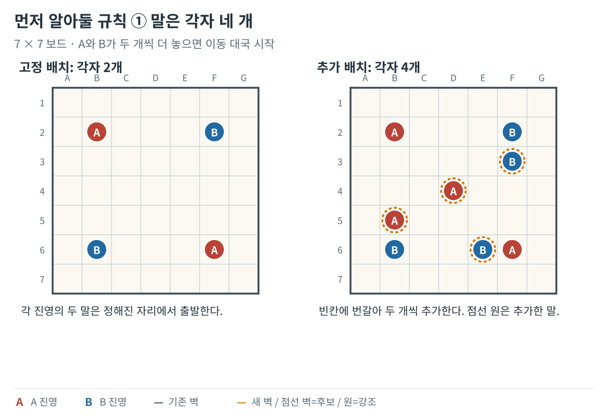
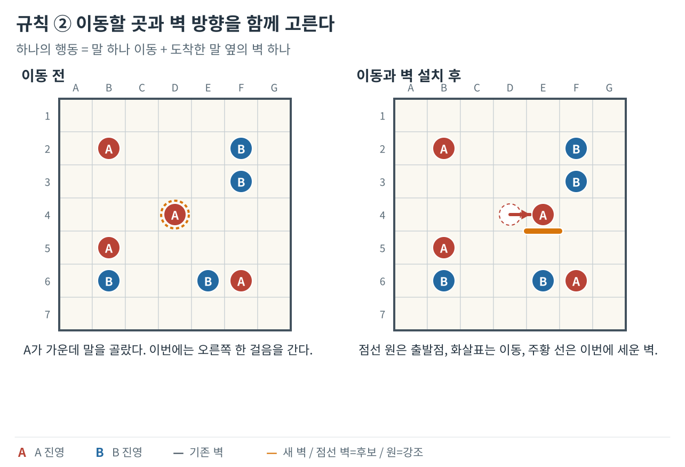
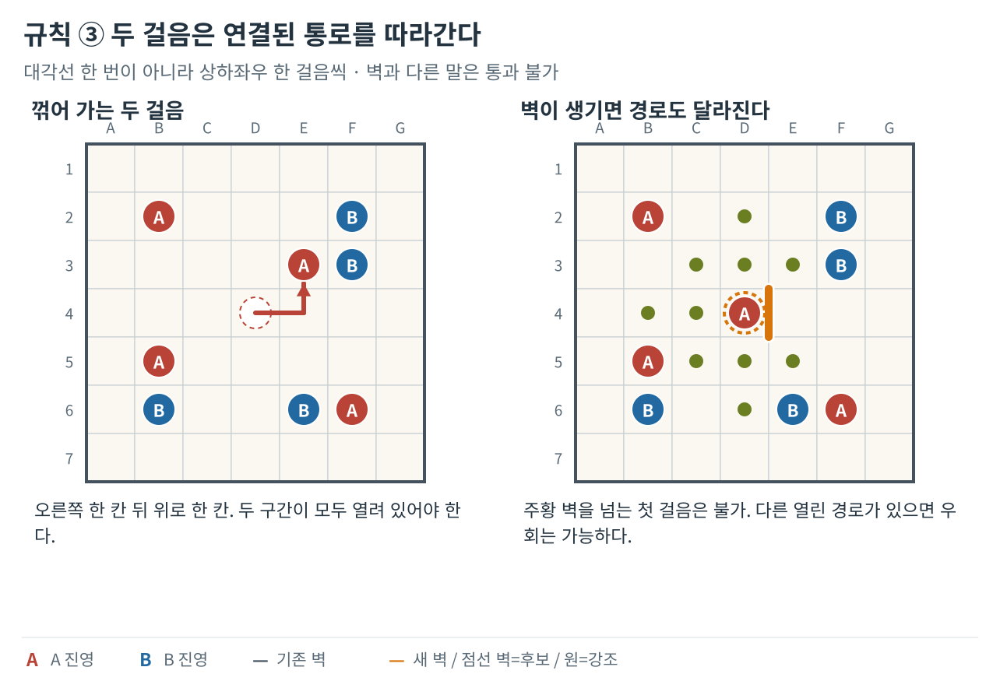
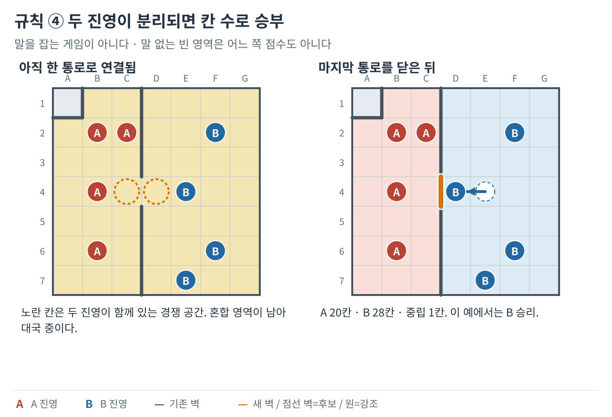
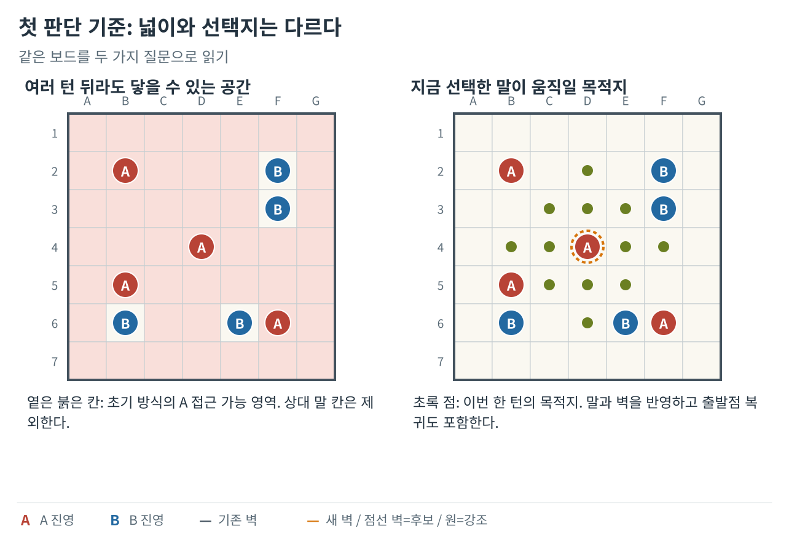
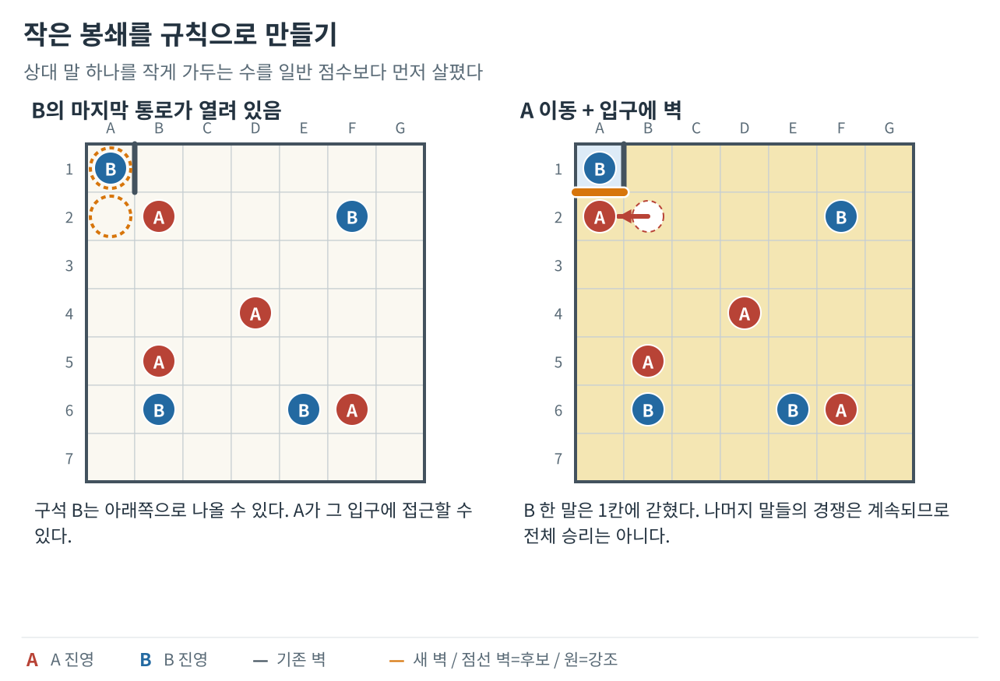
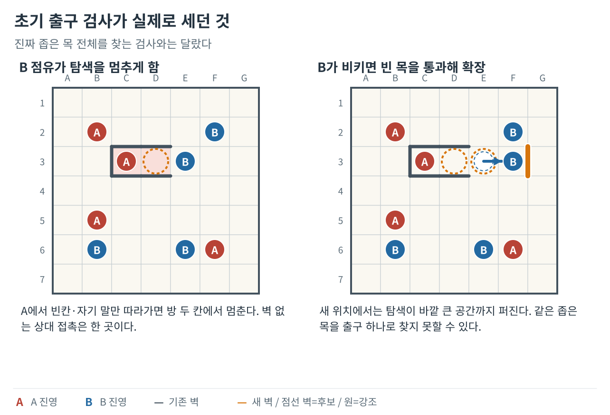
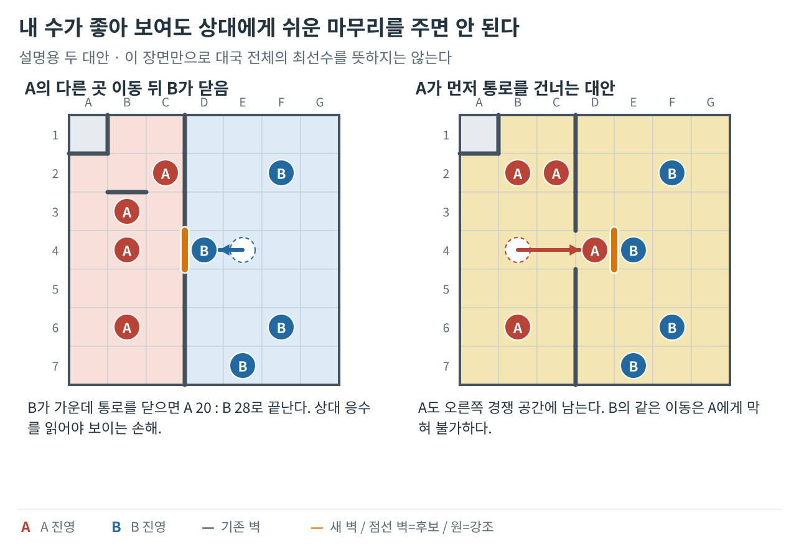
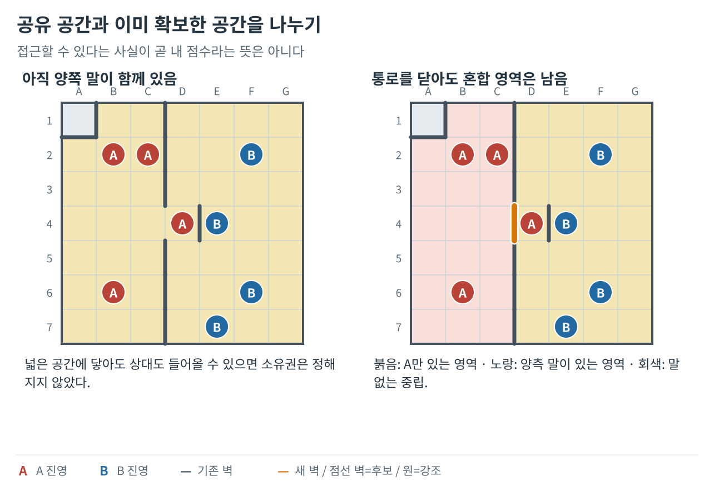

**벽바둑 봇 개발기 시리즈**

1. **좋은 수의 기준을 만들다 (현재 글)**
2. [안전한 수를 찾고 탐색 시간을 관리하다](/posts/wallbaduk-bot-02/)
3. [기보에서 배워 Expert와 Sedol에 적용하다](/posts/wallbaduk-bot-03/)
4. [실전 패착을 재현해 엔진을 고치다](/posts/wallbaduk-bot-04/)

방송에 등장한 벽바둑 규칙으로 게임을 만들고 나니, 혼자 접속한 사람과 대국할 상대도 필요했다. 나는 참고할 이 게임의 전용 공략을 갖고 있지 않았다. 두 사람용 대전에서 양쪽 진영을 번갈아 맡아 수십 판을 두며, **무엇을 좋은 수라고 부를 것인지부터** 정리했다.

내 공간이 넓으면 좋은가. 상대를 가두면 언제나 이득인가. 길을 많이 남긴 말은 실제로 얼마나 유리한가. 그 질문을 숫자로 만들고, 내 수에 상대가 답하는 수인 응수를 읽고, 대국의 수순을 남긴 기보에서 배우는 모델을 붙였다. Expert와 Sedol은 그렇게 나온 결과다. 이 글은 그 사이에 무엇이 달라졌고 무엇은 끝내 해결하지 못했는지를, 보드 위의 상황으로 풀어 쓴 기록이다.

그림은 원리를 설명하기 위해 별도로 구성한 판이다. 실제 과거 대국의 캡처나 특정 봇이 실제 고른 수는 아니다. **A는 붉은 말, B는 파란 말, 기존 벽은 짙은 회색, 새 벽은 주황색**이다. 진영 색의 빈 점선 원은 이동 전 자리, 말이나 칸을 두른 주황 점선 원은 강조, 화살표는 실제로 밟는 경로, 주황 점선 벽은 아직 놓지 않은 후보를 뜻한다. 그림 안의 칸 좌표는 열 A–G, 행 1–7이며 행은 위에서 아래로 센다.

## 먼저 알아둘 게임 규칙

### 말 네 개로 공간을 나누는 게임

보드는 7×7, 모두 49칸이다. 각자 네 개의 말을 사용한다. 처음 두 개씩은 정해진 곳에 놓이고, 나머지 두 개씩은 빈칸에 번갈아 배치한다. A→B→A→B로 추가 배치를 마치면 마지막에 배치한 B가 먼저 이동한다. 배치의 선공과 이동의 선공이 다른 셈이다.

*왼쪽은 고정 배치, 오른쪽은 추가 배치를 끝낸 한 예다. 주황 점선 원이 추가한 말이다.*

### 한 사람의 한 턴은 이동과 벽 설치

말 하나를 골라 상하좌우로 최대 두 걸음 이동한 뒤, 도착한 말 옆의 경계에 벽 하나를 놓는다. 벽은 칸을 차지하지 않고 **칸과 칸 사이의 길**을 끊는다. 판 바깥쪽이나 기존 벽과 겹치는 곳에는 놓을 수 없다.

*출발점은 빈 점선 원, 이동은 화살표, 새 벽은 주황색으로 표시했다. 이동과 벽을 함께 골라야 다음 판이 정해진다.*

한 걸음만 가거나, 두 걸음 중간에 꺾거나, 한 걸음 나갔다 제자리로 돌아올 수도 있다. 대각선으로 뛰는 이동은 아니다. 벽과 다른 자기 말·상대 말을 통과하거나 그 말 위에 도착할 수 없다. 왕복도 실제로 나갔다 돌아올 빈 이웃 칸과 열린 길이 필요하다.

*두 걸음은 연결된 길이어야 한다. 대각선으로 뛰거나 벽·다른 말을 건너뛰지 않는다. 다른 열린 길을 통한 우회는 별개다.*

선택한 말이 전혀 움직일 수 없으면 제자리에서 벽을 둘 수 있다. 그 말 주변에 새 벽을 놓을 자리마저 없으면 벽 없이 차례를 넘기는 **pass**가 가능하다. 다른 자기 말이 움직일 수 있어도 선택한 말의 상태로 판단한다. 이동과 벽 설치는 합쳐서 60초이며 시간이 지나면 가능한 행동이 자동 처리된다.

### 언제 끝나고 누가 이기는가

벽을 넘지 않고 이어지는 칸들을 하나의 **영역**으로 본다. 여기서는 말이 길을 잠깐 막는 효과는 무시하고 벽만으로 연결을 나눈다.

| 영역 | 들어 있는 말 | 의미 |
| --- | --- | --- |
| A 순수 영역 | A만 있음 | 현재 A 말만 있는 공간 |
| B 순수 영역 | B만 있음 | 현재 B 말만 있는 공간 |
| 혼합 영역 | A와 B가 모두 있음 | 아직 양측이 경쟁하는 공간 |
| 중립 영역 | 말이 없음 | 어느 쪽 점수도 아닌 공간 |

혼합 영역이 하나라도 남으면 계속 둔다. 모든 영역에서 양측 말이 분리되면 즉시 끝나고, 자기 순수 영역들의 칸 수를 합친다. 말이 서 있는 칸도 포함하며 큰 쪽이 이긴다. 같으면 무승부다. 영역의 **개수**나 살아 있는 말의 **개수**를 겨루는 것이 아니다. 이동 직후 이미 분리 조건을 만족했다면 새 벽을 덧붙이지 않고 끝난다.

*두 진영의 말이 같은 연결 영역에 남아 있으면 계속 둔다. 마지막 통로를 닫은 오른쪽은 A 20칸, B 28칸, 중립 1칸으로 B가 이긴다.*

이제 봇이 풀어야 할 문제가 보인다. **어느 말을 어디로 옮기고 어느 길을 끊어야, 마지막에 내 공간이 더 크게 남을까?**

## 1. 넓어 보이는 판에서, 무엇을 셀지 정하다

**핵심 변화 — 직접 플레이한 판단을 도달 공간·이동성·봉쇄 조건으로 수치화했다.**

말이 어디로 가는지만으로는 좋은 수를 고르기 어려웠다. 이동 위치에 따라 세울 수 있는 벽이 달라지고, 그 벽은 다음 차례의 길과 최종 땅을 바꾼다. 나는 말 선택과 이동, 벽 방향을 하나의 행동으로 묶었다. 후보마다 판을 복사해 그 행동을 가상으로 적용한 뒤 결과를 비교했다.

직접 플레이하며 생각한 문제들을 셀 수 있는 항목으로 바꿨다. 내 말들이 접근할 공간이 넓은지, 이동 선택지는 많은지, 상대를 막는 벽이 내 공간도 잘라 버리는지를 따로 봤다. 이동성은 말별 이동 선택지를 더한 값으로 봤다. 초기 기본 평가에서는 양쪽 도달 공간 차이 한 칸을 3점, 이동성 차이 한 단위를 1점으로 두었다. 상대 공간을 줄여도 나보다 넓게 남겨 주는 경우와 작게 가두는 경우에는 다른 보정을 줬다. 내가 정한 설계값이며, 학습으로 찾아낸 최적 비율은 아니었다.

여기서 도달 공간은 각 말의 영역을 무작정 더한 값이 아니었다. 같은 편의 여러 말이 갈 수 있는 칸을 한데 모아, 겹친 칸은 한 번만 셌다. 자기 말이 선 칸도 포함하고 통과했지만 상대 말이 선 칸에는 들어가지 않았다. 반면 양쪽은 별도로 계산했으므로 같은 빈칸이 양쪽 통계에 모두 들어갈 수 있었다. 이 값은 지금 접근할 수 있는 넓이였고, 이미 확보한 땅과는 달랐다.

*도달 공간은 옅은 붉은 칸, 지금 선택한 말의 목적지는 초록 점이다. 넓이와 당장 쓸 수 있는 선택지는 서로 다른 질문이다.*

작은 봉쇄에는 점수 비교보다 앞서는 규칙도 뒀다. 상대 말 하나의 도달 공간이 줄어 네 칸 이하가 되고, 내 말을 모두 치워도 크기가 그대로라면 첫 조건 충족 후보를 골랐다. 내 말이 잠깐 막은 길을 벽의 봉쇄로 오해하지 않으려는 검사였다. 상대의 다른 말들이 가진 땅까지 합쳐 승리를 확인하는 절차는 아니었다.

*상대 한 말을 작게 가둘 수 있다. 그러나 다른 말들의 경쟁이 계속되므로 이 장면만으로 전체 승리가 확정되지는 않는다.*

출구 쪽으로 접근하는 보너스도 만들었지만, 이름만큼 넓은 기능은 아니었다. 초기 탐지는 이어진 빈칸과 자기 말 칸을 훑으며 벽 없이 판 밖이나 상대 말 쪽으로 닿는 경계가 정확히 하나인지 셌다. 빈칸으로 이어진 좁은 목은 그대로 통과하므로 모든 관문을 찾지는 못했다. 출구까지의 거리도 가로·세로 차이를 더한 값이라 벽을 우회할 실제 이동 시간은 알 수 없었다. 전략에 붙인 이름과 실제로 측정한 범위를 구별해야 했다.

*왼쪽의 초기 검사는 빈칸과 자기 말만 따라가다가 상대 점유를 만나는 경계 한 곳을 센다. B가 비킨 오른쪽은 같은 빈 목을 지나 바깥으로 탐색하므로 일반적인 관문 검사와 다름을 볼 수 있다.*

## 2. 내 한 수의 이익에, 상대의 대답을 붙이다

**핵심 변화 — 내 수의 점수만 보던 판단에 상대의 강한 응수와 다음 내 수를 붙였다.**

같은 공간이라도 내가 벽을 세운 다음 상대가 무엇을 하느냐에 따라 가치가 달라진다. Easy는 후보 행동을 한 번 적용한 결과를 점수로 비교했다. Medium에는 ‘내 수, 상대 수, 다시 내 수’를 읽는 탐색을 붙였다. 내 차례에는 점수가 높은 쪽을, 상대 차례에는 내 점수를 가장 낮추는 응수를 고르는 방식이다. 상대도 자기에게 유리하게 둘 것이라는 전제를 계산에 넣은 셈이다.

하지만 가능한 수를 전부 세 턴 앞까지 읽은 것은 아니었다. 초기 Medium은 직선 한두 칸 이동을 중심으로 후보를 만들었고, 수가 많으면 섞은 뒤 일부만 남겼다. 꺾는 이동과 원위치 복귀를 포함한 실제 규칙의 모든 선택지가 그 후보에 들어가지는 않았다. 더 멀리 본다는 이름만으로 좋은 응수가 빠지지 않는다고 할 수 없었다.

점수에 넣어 둔 항목도 실제 계산에서는 다르게 작동할 수 있었다. 초기 Easy는 가상으로 옮긴 말의 좌표를 쓰면서, 길을 막는 벽과 말은 화면에 있는 현재 판에서 읽었다. 새로 세울 벽이 상대의 이동을 줄여도 그 변화가 반영되지 않아 상대 이동성 감소 점수는 실제로 0이 됐다. 출구 도달 가능 여부도 계산 뒤 최종 후보로 전달되지 않아 사용하려던 보정이 활성화되지 않았다. 식을 작성하는 일과 필요한 정보가 선택까지 도착하게 만드는 일은 따로 확인해야 했다.

나는 화면을 직접 누르지 않고도 같은 시작 판에서 연속 대결하고, 난수도 다시 재현할 수 있도록 상태와 계산을 분리했다. 초기 비교에서는 네 조합을 각 500판씩 실행했다. 안전을 지향하는 상대에게 Easy의 승률은 88.4%, Medium은 59.6%로 나왔다. 더 깊이 읽는 쪽이 약하게 나타난 것이다. 다만 이 비교는 20턴 제한에 닿으면 도달 공간으로 승패를 정했으므로, 실제 끝까지 둔 대국의 승률과 같지는 않았다.

이 결과를 깊이만의 문제로 해석할 수는 없었다. 빠진 합법 수, 후보를 자르는 방식, 서로 다른 평가, 가상 판과 화면 상태의 혼합이 함께 있었다. 탐색을 더 늘리기 전에 어떤 수를 만들고 어떤 판을 평가하는지부터 바로잡아야 했다.

*왼쪽은 A가 다른 곳을 둔 뒤의 B 응수다. 오른쪽은 같은 출발 판에서 A가 통로를 건너는 다른 선택이다. 이어진 한 수순이 아니라 두 대안의 비교다.*

## 3. 갈 수 있는 공간과, 실제로 확보한 땅을 나누다

**핵심 변화 — 갈 수 있는 공간을 이미 내 말만 있는 영역과 구분하고 자기 고립을 감점했다.**

도달 공간만으로는 벽을 세운 결과를 충분히 설명하기 어려웠다. 양쪽이 함께 들어갈 수 있는 넓은 공간은 아직 경쟁 중인 땅이다. 그 공간을 나눴다는 사실만 보상하면, 큰 쪽을 상대에게 넘기는 벽도 좋은 수처럼 보일 수 있다. 상대 말 하나를 막으면서 내 말을 더 작은 방에 가두는 일도 구별해야 했다.

나는 벽만을 경계로 공간을 나눠 네 종류로 셌다. 내 말만 있는 공간, 상대 말만 있는 공간, 양쪽 말이 함께 있는 공간, 아무 말도 없는 공간이다. 말이 통로에 잠깐 서 있는 효과와 벽이 길을 끊는 효과를 분리했다. 내 말만 있는 순수 영역과 양쪽이 함께 있는 혼합 영역을 구분하면서, 지금 갈 수 있는 넓이뿐 아니라 그 공간이 누구에게 귀속되는지를 평가에 넣었다.

순수 영역과 혼합 영역의 개수·넓이, 상대와 닿는 방향, 출구 등을 기존 점수에 더했다. 이후에는 도달 공간 차이를 중심에서 빼고 순수 영역과 이동 선택지, 작은 고립을 직접 봤다. 후보 정렬과 상위 후보의 재평가에도 행동 전후의 변화를 넣었다.

특히 여섯 칸 이하의 자기 순수 영역을 작은 고립으로 따로 다뤘다. 상대를 작게 가두면 가산하고 나를 작게 가두면 감점했다. 자기 출구를 닫는 보정은 한 단계에서 120점 가산에서 140점 감점으로 바뀌었다. Easy에도 자기 출구 봉쇄와 작은 고립 감점을 넣었다. 이미 작게 갇힌 말도 무조건 후보에서 빼지 않고 이동 뒤 상태를 평가했다.

중요한 질문은 벽을 얼마나 많이 닫았느냐에서 누구를 어느 크기로 가두었고, 그 뒤 움직일 선택지가 남느냐로 옮겨 갔다. 그러나 항목과 보정이 늘수록 같은 이익을 여러 번 세거나 서로 다른 판단이 충돌하기 쉬웠다. 초기 Easy의 화면 상태 결합도 여전히 남아 있었다. 특징을 계속 추가하는 방식만으로는 판단의 일관성을 확보하기 어려웠다.

*순수 영역, 혼합 영역, 중립 영역을 구분한다. 문을 닫아도 한쪽 방에 양측 말이 함께 있으면 그 방은 계속 경쟁 중이다.*

---

[다음 글: 안전한 수를 찾고 탐색 시간을 관리하다 →](/posts/wallbaduk-bot-02/)
