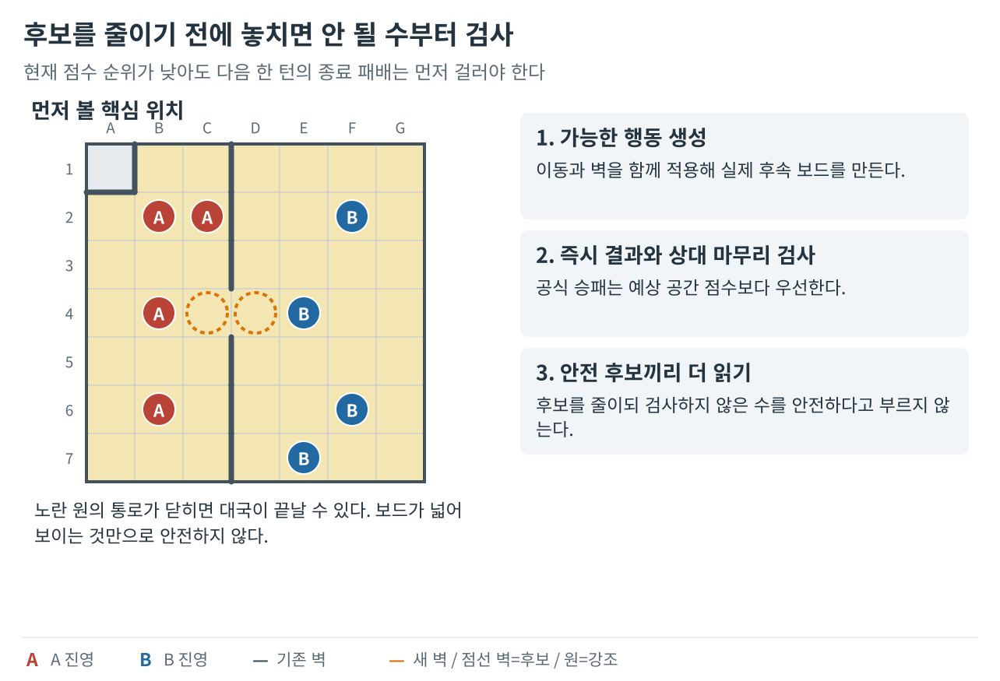
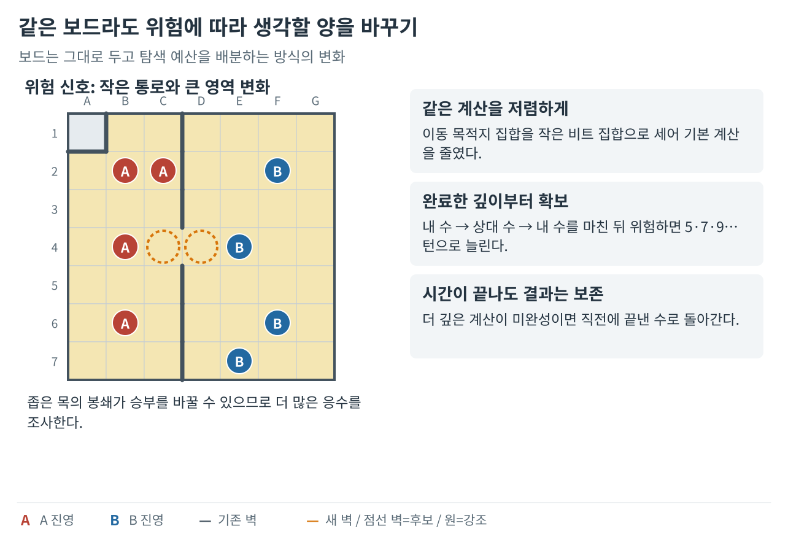

**벽바둑 봇 개발기 시리즈**

1. [좋은 수의 기준을 만들다](/posts/wallbaduk-bot-01/)
2. **안전한 수를 찾고 탐색 시간을 관리하다 (현재 글)**
3. [기보에서 배워 Expert와 Sedol에 적용하다](/posts/wallbaduk-bot-03/)
4. [실전 패착을 재현해 엔진을 고치다](/posts/wallbaduk-bot-04/)

1편에서 정한 평가 기준을 앱과 실험에 공통으로 적용했다. 이번 편에서는 바로 지는 수를 먼저 확인하고, 위험한 판에서 더 깊게 탐색해도 이미 완료한 판단을 잃지 않도록 한 과정을 다룬다.

게임 규칙과 그림 범례는 [1편](/posts/wallbaduk-bot-01/)에서 확인할 수 있다.

## 4. 판단 기준을 하나로 모으고, 당장 지는 수부터 확인하다

**핵심 변화 — 앱과 실험의 판단을 통일하고, 후보를 줄이기 전에 바로 지는 수를 검사했다.**

앱 안의 Easy, 별도 Medium, 대결 도구가 다른 길로 계산하면 실험 결과를 앱의 강도로 받아들이기 어렵다. 나는 두 난이도가 같은 합법 행동 생성, 같은 가상 판, 같은 종국 판정과 평가를 쓰도록 통일했다. 꺾는 이동과 왕복 이동도 실제 규칙대로 만들었다. 난이도의 차이는 서로 다른 목적보다 얼마나 상대의 응수까지 보느냐에서 나오도록 했다.

평가도 세 축으로 정리했다. 순수 영역의 칸 차이에는 100, 경쟁 중인 칸의 거리 영향력에는 24, 혼합 영역에 있는 말들의 이동성 차이에는 2의 가중치를 뒀다. 거리 영향력은 각 칸에 어느 편 말이 더 가까운지를 세되, 거리가 멀어진 만큼 끝없이 보너스를 늘리지 않았다. 이때 말 점유는 무시하고 벽으로 막힌 길을 반영했다. 현재의 접근 우세를 추정하는 값이며 앞으로 생길 벽과 실제 도착 순서를 예언하는 값은 아니었다.

공식 승패는 이런 추정 점수보다 먼저 처리했다. 작은 포획의 보너스가 대국 전체의 패배를 덮지 않게 했다. Medium에서는 좋은 점수의 후보를 몇 개 남기기 전에, 모든 최초 후보에 대해 상대가 바로 다음 차례에 이길 수 있는지 검사했다. 당장 지지 않는 수가 있다면 그 집합에서 탐색했고, 모두 당장 지는 경우에는 전체 후보를 비교했다. 정적 점수, 즉 상대의 후속 수를 읽기 전에 현재 판만으로 계산한 점수는 낮아도 유일한 방어인 수를 처음부터 버리지 않으려는 장치였다.

그 뒤 최초 후보 상위 12개와 상대 응수 상위 6개를 남기고, 마지막 내 차례는 전체 합법 행동을 평가했다. 여전히 후보를 제한한 세 턴 탐색이지만, 다음 한 턴의 공식 패배를 거르는 절차와 먼 형세를 추정하는 절차를 구분했다. 이 검사로 여러 턴 뒤의 모든 함정을 피할 수 있는 것은 아니었다.

같은 평가를 공유한 Easy와 16개 초기 배치에서 진영·선공을 바꿔 64판을 두었을 때 Medium은 55승 7패 2무였다. 모두 공식 종국까지 진행했고, 순수 승률은 85.94%였다. 무승부를 반 점으로 세면 점수율은 87.5%다. 비교 조건을 맞추고 나서야 응수 탐색이 난이도 차이를 만드는 모습을 확인할 수 있었다. 이는 그 상대와 배치에서의 성적이며 사람 상대 기력을 뜻하지는 않았다.

*미래 형세를 추측하기 전에 바로 끝나는 승패와 상대의 다음 턴 마무리를 먼저 본다. 검사 범위를 넘는 장기 안전까지 증명하는 것은 아니다.*

## 5. 위험한 순간에 더 읽고, 끝낸 판단을 지키다

**핵심 변화 — 위험한 판에 계산을 더 쓰되 중단되어도 마지막 완료 판단을 지켰다.**

다음 문제는 제한된 시간을 어디에 쓰느냐였다. 후보를 넓게 읽는 방법과 깊게 읽는 방법을 비교했지만, 어느 쪽이 언제나 낫다고 단정할 수는 없었다. 임시 자료를 줄여 같은 판단을 더 싸게 계산하는 일도 필요했다.

이동성 계산에는 목적지마다 작은 스위치를 켜는 방식을 썼다. 실제 목적지는 제자리를 포함해 최대 13곳이지만, 내부에서는 그 위치들을 담는 29자리 비트 집합을 사용했다. 비트는 켜짐과 꺼짐을 저장하는 작은 자리다. 같은 칸에 닿는 여러 경로는 한 번만 셌다. 같은 컴퓨터에서 계산 프로그램을 미리 실행용 코드로 변환한 뒤 판 상태 12개를 비교했을 때, 평균 계산 시간은 30.16ms에서 24.95ms로 약 17.3% 줄었다. ms는 천분의 일 초다. 같은 판단의 계산 비용을 줄인 개선이며, 휴대폰 화면 전체의 응답 시간은 아니다.

모든 판에 똑같이 시간을 더 쓰지는 않았다. 기본은 세 턴을 읽고, 혼합 공간이 24칸 이하이거나 상위 후보 뒤 순수 칸 합이 네 칸 이상 바뀌거나, 혼합 공간을 둘로 나눌 길의 양쪽에 말이 있으면 다섯 턴 탐색을 시도했다. 초기 적응형의 예산은 100ms, 즉 0.1초와 위치 평가 18,000회였다. 새 16개 배치의 64판에서 고정 세 턴 상대에게 45승 19패를 기록했다. 위험할 때 더 읽는 방향에 근거가 생겼지만 모든 국면의 우세를 보장하지는 않았다.

다섯 턴을 읽다가 시간이 끝나면 일부 후보만 깊게 읽은 값으로 답을 바꾸지 않았다. 전체 비교를 끝낸 세 턴의 최선수를 유지했다. 가상으로 움직인 판도 계산을 중단할 때 반드시 되돌렸다. 더 깊이 보기 시작했다는 사실보다 어디까지 온전히 비교했는지가 중요했다.

짧은 예산이 언제나 충분한 것도 아니었다. 가상화 가속이 없는 느린 Android 실행 환경에서는 0.1초가 기본 탐색을 마치기도 전에 끝나 기력이 떨어졌다. 계산 자원이 부족해 읽지 못한 경우와, 같은 Expert의 시간을 더 늘려도 개선이 없던 비교는 서로 다른 질문이었다.

이후에는 긴 시간도 실제 탐색에 쓰도록 세 턴, 다섯 턴, 일곱 턴처럼 최대 열다섯 턴까지 반복해서 깊이를 늘렸다. 평온하면 짧게 끝내고, 위험하면 더 읽되 10초가 지나면 새 반복을 시작하지 않았다. 전체 요청에는 15초를 목표로 한 별도 중단 상한을 두었다. 내부 시간 확인만으로 모든 환경의 정확한 마감을 보장하는 구조는 아니었다. 같은 요청에서 다시 만난 판의 계산은 저장해 재사용했고, 이전에 끝낸 최선수는 다음 깊이의 후보에 반드시 남겼다. 그래도 폭을 제한한 탐색이므로 열다섯 턴을 읽었다는 말이 가능한 모든 미래를 확인했다는 뜻은 아니었다.

긴 계산은 화면과 별도 작업으로 실행했다. 내부의 시간 확인만으로는 시작과 전달 지연까지 관리할 수 없어, 요청을 관리하는 쪽에서도 작업을 끝낼 수 있게 했다. 합법 대체 수, 검증된 안전 수, 완성한 탐색 결과를 순서대로 받았다. 합법인 대체 수가 안전까지 보장하지는 않았다. 차례나 판이 바뀌면 늦게 온 답은 버렸다. 작업은 요청마다 새로 만들었고 결과 재사용도 같은 요청 안에서만 이뤄졌다.

장시간 정책은 고정된 네 초기 배치에서 선공과 진영을 바꿔, 짧은 예산 상대와 예산만 늘린 상대에게 각각 16판씩 두어 두 조합 모두 12승 4패를 기록했다. 다만 독립 배치가 네 개뿐이라 일반적인 강도를 정하기에는 부족했다. 새 봇의 요청 시간 평균도 약 4.12초였다. 성장의 의미는 언제나 빨리 답하게 된 데 있지 않았다. 위험할 때 시간을 쓰면서도, 끝내지 못한 계산 때문에 이전 판단을 잃거나 오래된 답을 현재 판에 놓지 않게 된 데 있었다.

*위험한 순간에는 더 읽되, 미완성의 깊은 값으로 이전의 완성된 판단을 덮지 않는다.*

---

[← 이전 글: 좋은 수의 기준을 만들다](/posts/wallbaduk-bot-01/)

[다음 글: 기보에서 배워 Expert와 Sedol에 적용하다 →](/posts/wallbaduk-bot-03/)
