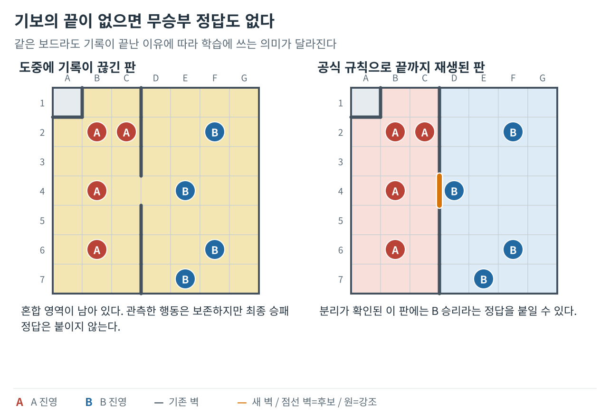
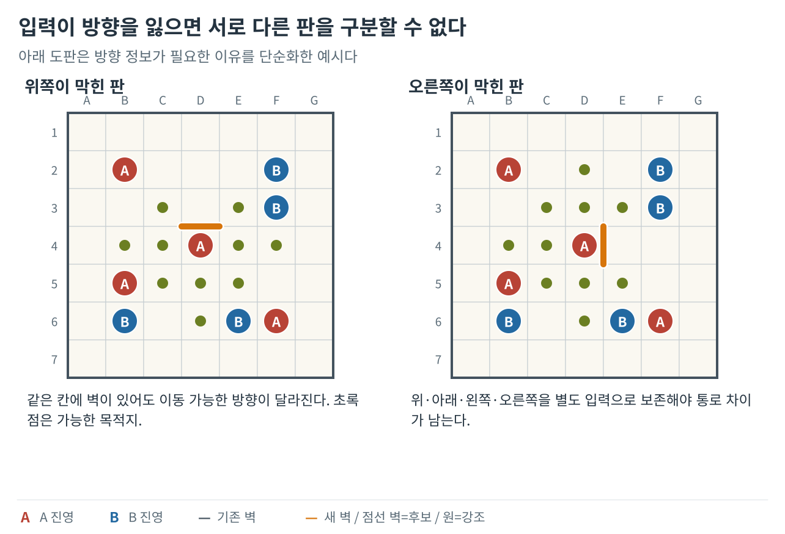
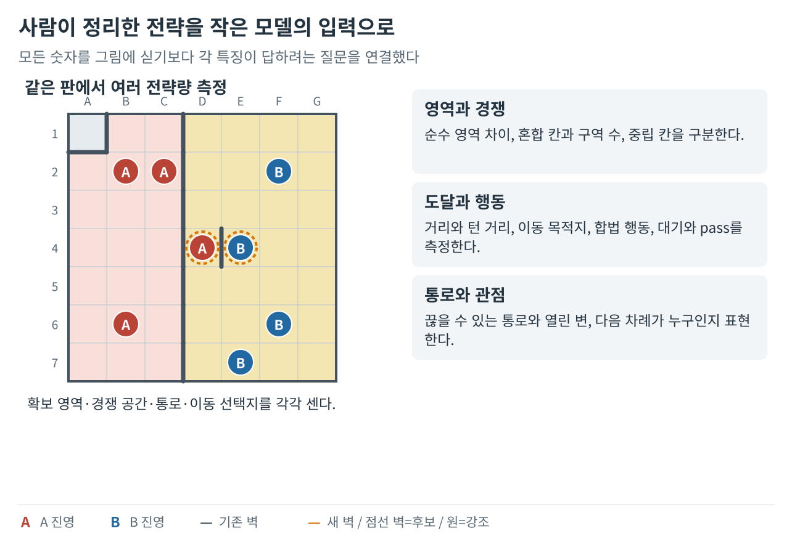
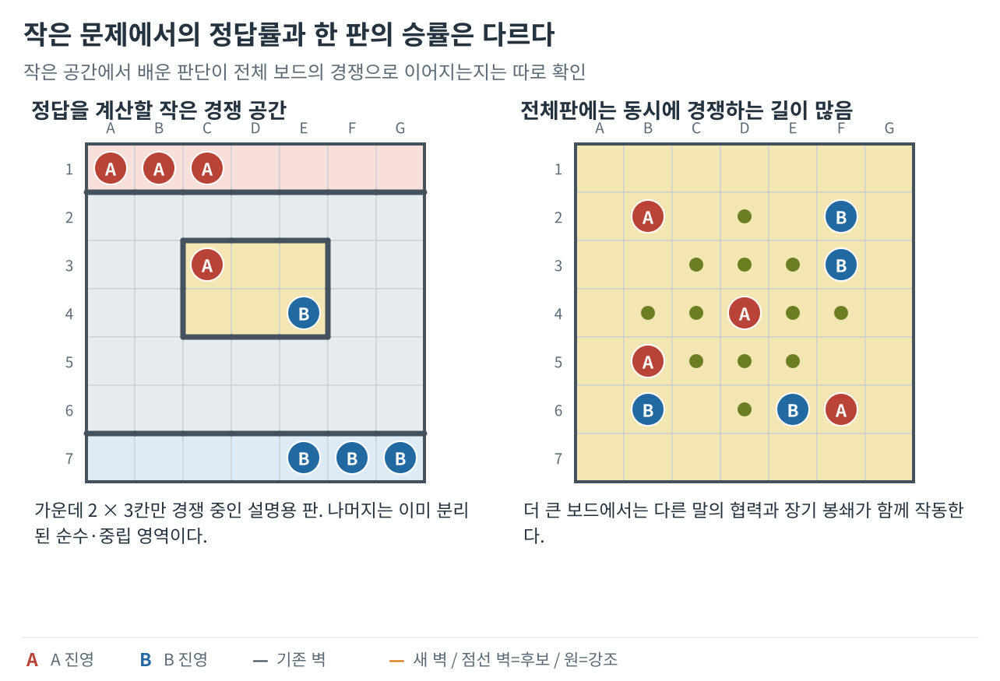
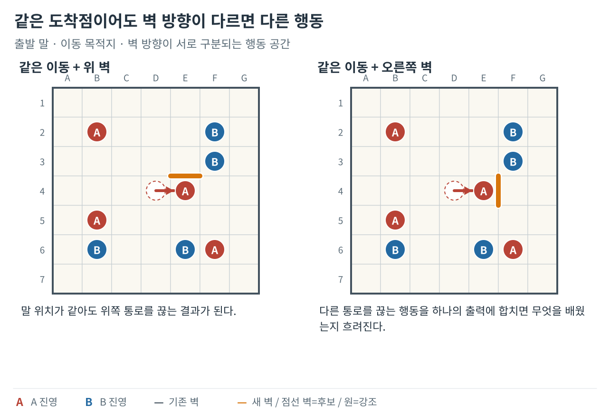
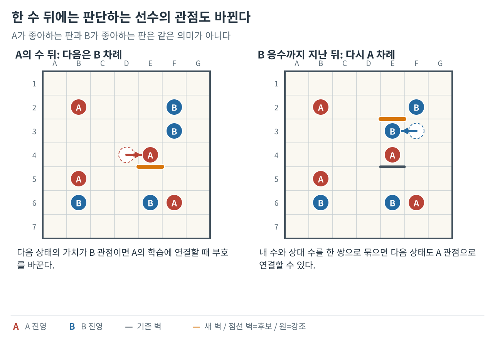
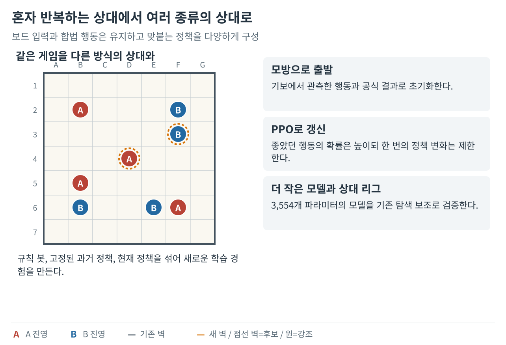
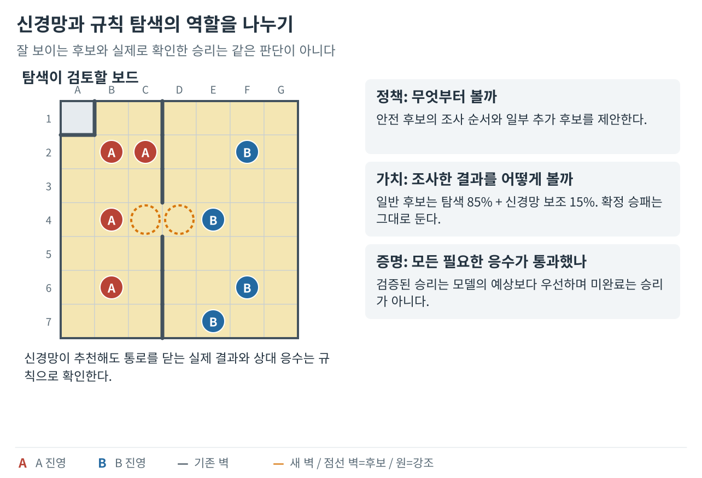
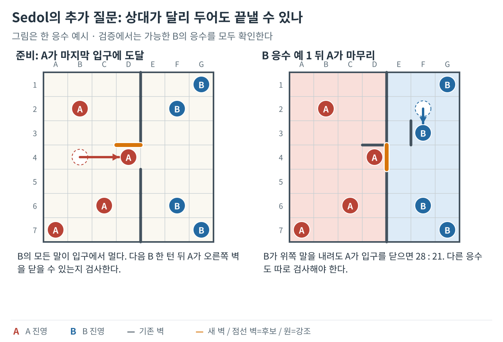
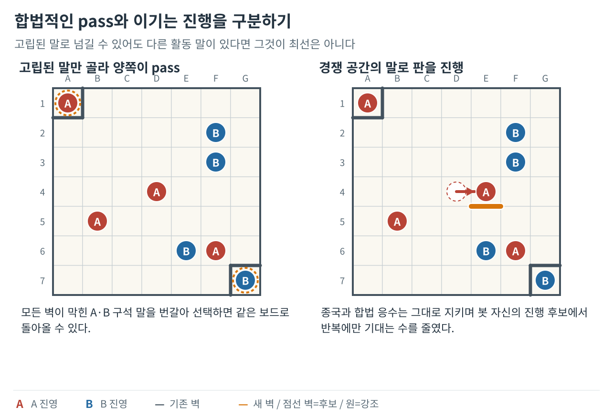

**벽바둑 봇 개발기 시리즈**

1. [좋은 수의 기준을 만들다](/posts/wallbaduk-bot-01/)
2. [안전한 수를 찾고 탐색 시간을 관리하다](/posts/wallbaduk-bot-02/)
3. **기보에서 배워 Expert와 Sedol에 적용하다 (현재 글)**
4. [실전 패착을 재현해 엔진을 고치다](/posts/wallbaduk-bot-04/)

앞선 두 편에서는 규칙에 따라 수를 평가하고 상대 응수를 탐색하는 봇을 만들었다. 이번에는 실제 기보의 결과와 행동부터 검증하고, 그 데이터를 학습한 작은 모델을 탐색에 붙인다.

게임 규칙과 그림 범례는 [1편](/posts/wallbaduk-bot-01/)에서 확인할 수 있다.

## 6. 먼저, 기보를 정답으로 바꾸는 일을 고쳤다

**핵심 변화 — 기보의 수량보다 규칙·결과·입력·행동의 정확성을 먼저 바로잡았다.**

초기 온라인 기보에는 최종 승패와 종료 이유가 빠져 있었다. 그런데 변환 과정에서는 결과가 없으면 무승부로 처리했다. 학습 예제의 가치 정답이 전부 0이 된 이유였다. ‘비겼다’와 ‘어떻게 끝났는지 모른다’는 전혀 다른데, 모델에는 같은 답을 가르친 셈이었다.

턴 제한에 걸린 대국도 마찬가지였다. 아직 경쟁 중인데 수집을 멈췄다고 무승부가 되지는 않는다. 나는 전체 수순을 실제 앱 규칙으로 다시 실행해 공식 종국까지 유효한 기보를 선별했다. 중간까지 합법인 수순은 보존하되 승패를 붙이지 않았고, 잘못된 벽이나 차례를 임의로 고쳐 완주한 것처럼 만들지 않았다. 학습용 대국이나 정답을 만드는 별도 규칙 봇을 교사로 사용했는데, 이 교사가 앱과 다른 규칙으로 만든 자료도 새 학습에 그대로 섞지 않았다.

한 보드에서 가능한 수를 백 개 펼쳐도 실제로 선택한 수는 하나다. 실제 선택 뒤의 승패를 선택하지 않은 나머지 수에도 복사하면, 실행하지 않은 수의 결과까지 아는 척하게 된다. 나는 관측한 행동과 가상 대안을 분리하고, 같은 대국을 여러 번 저장한 중복도 제거했다. 회전·반사·색 교환으로 같은 시작 배치는 한 묶음으로 나눴다. 학습에서 본 배치를 뒤집은 것이 시험에 나와서는 새 문제를 풀었다고 보기 어렵기 때문이다.

*기보가 끊겼다는 사실과 비겼다는 결과를 구별했다. 승패가 확인되지 않은 수순에 무승부 정답을 만들어 붙이지 않는다.*

모델의 표현에도 문제가 있었다. 초기 신경망은 내 말 네 개와 상대 말 네 개, 색별 벽 두 장, 차례 한 장을 겹친 11채널 보드를 읽었다. 그런데 벽의 색만 담고 방향을 잃어, 오른쪽 길이 열린 보드와 위쪽 길이 열린 보드를 구별하지 못할 수 있었다. 통로가 다르면 가능한 수도 다른데 모델에게는 같은 문제로 보였다.

신경망은 보드의 입력에서 패턴을 읽고 학습으로 조정한 숫자를 조합해 답을 내는 모델이다. 초기 출력은 행동을 200개 슬롯에 넣었다. 한 국면의 합법 행동 144개가 52개 슬롯에 합쳐진 사례가 나왔다. 다른 수들이 같은 버튼을 공유한 것이다. 학습한 확률이 어느 실제 행동을 뜻하는지 모호해졌다. 학습으로 조정하는 숫자, 즉 파라미터가 약 56만 개 있고 연습 중 예측 오차가 줄어도, 입력과 출력의 대응이 틀리면 그 앞에서 막혔다.

초기 모델은 ‘어느 수를 둘지’라는 정책과 ‘이 보드가 얼마나 유리한지’라는 가치를 함께 학습했다. 하지만 실제 선택은 정책을 한 번 읽는 방식이었고 가치는 사용하지 않았다. 탐색 횟수 설정도 상대 응수를 읽는 과정에 연결되지 않았다. 자기대국으로 모은 자기 정책을 다시 따라 배우는 구조를, 탐색이 더 좋은 정답을 만들어 주는 학습과 같다고 설명할 수는 없었다.

*방향 정보가 필요한 이유를 단순화한 예시다. 옛 입력으로 충돌했던 실제 시험판을 복제한 그림은 아니다.*

## 7. 작은 판에서는 배웠지만, 전체판에서는 다시 실패했다

**핵심 변화 — 작은 공간의 학습 성과가 전체 대국의 강도로 곧바로 이어지지 않음을 확인했다.**

다음에는 정답을 확실히 만들 수 있는 작은 공간부터 실험했다. 벽으로 제한된 판에서 상대의 가능한 응수를 모두 조사해, 어떤 수가 승리를 강제하는지 계산했다. 말 이동과 벽 설치를 끝낸 후보 보드를 입력으로 주고, 그 뒤의 강제 결과는 정답으로만 사용했다. 미래의 답을 입력에 슬쩍 넣지 않는 것이 중요했다. 중간 범주에는 어느 쪽도 승리를 강제하지 못하는 비종료 가능 상태도 들어가므로, 모델의 출력 확률을 실전 승률로 볼 수는 없었다.

처음에는 보드 전체 대신 판단에 필요한 숫자 13개를 골랐다. 이름은 많지만 다음 여섯 묶음으로 이해할 수 있다.

| 묶음 | 담은 특징 | 보드에서 묻는 질문 |
|---|---|---|
| 영역 4개 | 확정 영역 차이, 혼합 칸 수, 혼합 영역 묶음 수, 중립 칸 수 | 이미 내 말만 있는 공간은 얼마나 되며, 아직 양쪽이 경쟁하는 공간은 얼마나 남았나? |
| 접근 2개 | 거리 영향력, 두 걸음 기준 턴 거리 근사 | 경쟁하는 칸에 누가 더 가까운가? 벽을 반영한 거리를 쓰지만 실제 미래 소유의 증명은 아니다. |
| 선택지 2개 | 이동성 차이, 합법 행동 수 차이 | 혼합 영역의 말들이 한두 걸음으로 갈 고유 목적지는 몇 개이며, 실제로 둘 수 있는 이동·벽 조합은 얼마나 되나? |
| 대기 2개 | 영역을 유지하는 벽 설치 후속 보드 수 차이, 무벽 pass 가능 여부 차이 | 영역 차를 바꾸지 않고 차례를 소비할 선택지는 얼마나 되며, 벽 없이 넘길 수는 있나? |
| 통로 2개 | 절단 가능 통로 수, 열린 인접 변 수 | 끊으면 공간이 갈라지는 길과 벽 없이 연결된 이웃은 얼마나 남았나? |
| 차례 1개 | 판단 주체와 다음 차례의 관계 | 다음에 두는 쪽이 나인가, 상대인가? |

*사람이 설명할 수 있는 13개 전략 특징을 만들었다. 입력을 만드는 규칙과 그 입력의 조합을 학습하는 일은 다르다.*

거리 특징은 다른 말의 점유를 무시한 근사였고, 이동성은 벽과 말 점유를 반영했다. 이동성에는 두 걸음 왕복으로 제자리에 돌아오는 경우도 포함했다. 대기 선택지는 양쪽 순수 영역의 칸 수가 모두 유지되는 서로 다른 후속 보드를 셌을 뿐, 그 수가 안전한 승리를 보장한다는 뜻은 아니었다. 통로 특징도 갈라진 양쪽에 말이 있는 길만 세는 값은 아니었다.

특징을 만드는 규칙은 내가 정했고, 이 숫자들을 어떤 비중으로 조합할지는 모델이 배웠다. 선형 모델은 입력에 곱할 비중을 바로 학습하는 모델로 42개, 작은 다층 신경망인 MLP는 275개 파라미터였다. 훈련에서 pass 가능 여부 차이는 늘 0, 다음 차례 관계는 늘 −1이었다. 이런 입력을 외부 보드에서 갑자기 활성화하면 배우지 않은 가중치가 판단에 끼어들었다. 그래서 두 입력은 학습할 때와 실제 판을 판단할 때 모두 0으로 막았다.

작은 외부 국면 256개에서 최선 결과를 고른 횟수는 수작업 평가 228개, 선형 모델 251개, MLP 246개였다. 입력과 출력 사이에 추가 계산층인 은닉층이 없는 모델이 오히려 더 좋았다. 이웃한 칸의 패턴을 읽는 신경망인 CNN과, 보드 값을 일렬로 펼쳐 읽는 MLP도 비교했다. 분할의 중복을 제거하고 공간 모델에는 회전·반사 증강을 적용했지만, 새 작은 판의 강제 승리 265개 중 놓친 수는 선형 11개, CNN 19개, 보드 MLP 117개였다. 모델을 키우는 것만으로는 나아지지 않았다.

결정적인 시험은 전체 7×7 보드였다. 선형 모델을 연구용 탐색 엔진에 붙이고 새 16배치에서 양쪽 색으로 32판을 두었지만 14승 17패 1무였다. 평가 호출 비용도 늘어 제품에는 채택하지 않았다. 작은 판에서 후보를 맞힌 비율과, 그 평가를 수없이 호출하는 전체 대국의 승률은 다른 목표였다. 더 큰 작은 판의 정확한 정답 생성도 시간과 메모리 때문에 중단했고, 예측 확률을 완만하게 하거나 날카롭게 조정하는 보정은 새 종류의 국면에서 오히려 나빠졌다.

*왼쪽은 정답 계산 원리를 설명하는 작은 경쟁 공간이다. 작은 문제의 정답률과 오른쪽 같은 전체 대국의 승률을 같은 지표로 취급하지 않았다.*

## 8. 제대로 표현한 뒤, 작은 모델을 탐색의 보조로 썼다

**핵심 변화 — 보드와 행동을 명확히 표현하고 작은 모델을 여러 상대와 학습했다.**

새 정책 학습에서는 보드 표현부터 바꿨다. 내 말과 상대 말 두 장, 네 방향 벽 네 장, 차례 한 장의 7채널을 사용했다. 행동은 출발칸 49개, 제자리를 포함한 두 걸음 이내 이동 13개, 네 방향 벽과 무벽의 다섯 선택을 조합한 3,185개로 만들었다. 불법 수의 확률은 0으로 가리고, 완전히 같은 후속 보드를 만드는 행동은 대표 하나로 묶었다. 이제 모델의 선택과 실제 수를 충돌 없이 연결할 수 있었다.

*말이 같은 칸에 도착해도 벽 방향이 다르면 다른 행동이다. 출발점과 도착점, 벽 방향을 구별해 학습 출력과 실행을 연결했다.*

먼저 공식 대국에서 선택한 수를 따라 배우고 결과를 예측하게 했다. 이것이 행동 복제인 BC였다. 교사도 최선수만 두는 것은 아니므로 관측 수를 잘 맞힌다고 곧바로 강한 봇이 되지는 않는다. BC는 무작위 출발을 줄이는 준비였고, 그다음에는 현재 정책으로 새 대국을 두며 배웠다.

여기서 관점을 맞추는 일이 중요했다. 내 차례의 ‘유리함’과 상대 차례의 ‘유리함’은 부호가 반대다. 내 수 뒤에 상대가 좋아졌다면 내가 좋아진 것이 아니다. TD는 이번 보상과 다음 가치로 현재 예측을 고칠 차이를 계산했고, GAE는 그런 차이를 여러 수에 걸쳐 연결해 행동의 이점을 추정했다. 한 사람의 한 턴마다 차례가 바뀌는 학습에서는 다음 가치와 다음 이점의 부호를 뒤집었다.

PPO는 그 이점에 따라 좋은 행동의 확률을 높이고 나쁜 행동은 줄였다. 한 번에 정책을 크게 바꾸도록 부추기지 않게 확률 비율의 이득 계산을 제한하고, 너무 일찍 한 수에만 몰리지 않도록 했다. 보상은 공식 승패에만 주었다. 반복이나 턴 한도로 멈추면 마지막 실제 보드의 가치로 남은 결과를 추정하되, 새 대국의 결과를 앞 대국에 이어 붙이지 않았다.

*한 사람의 한 턴 뒤의 가치는 상대 관점이다. 내 수와 상대 응수를 묶어 다음 내 차례로 연결할 때와 부호 처리가 다르다.*

42,434파라미터 모델로 1,048,576개 결정을 학습했지만 신경망 단독 정책은 약했다. 500ms Medium 상대 경과 관측 4판은 1승 3패, 학습에서 제외해 둔 배치의 별도 평가 8판은 전패였다. 학습을 실제로 많이 했다는 사실과 강해졌다는 결과는 달랐다.

다음에는 3,554파라미터의 더 작은 CNN을 새로 학습했다. 비교에 쓰는 확장 규칙 봇은 앞선 Medium에 준비 수·반복 대응·추가 승리 검사를 넣은 규칙 탐색기다. 큰 모델은 고정 상대에 넣고, 실제 규칙 봇 25%·과거 정책 50%·현재 정책 25%의 확률로 대국 상대를 골랐다. 규칙 봇의 외부 예산은 100ms였다. 내 수와 상대 응수를 묶어 다음 내 차례로 이어지게 하자 다음 가치의 부호를 뒤집지 않고 더했다. 가치 자체가 언제나 양수라는 뜻은 아니다. PPO 뒤에는 작은 교사 복습도 따로 더했다. 상대 수를 내 정책의 정답으로 바꾼 것은 아니었다.

131,072개 결정을 거친 마지막 모델은 기존 탐색에 붙여 평가했다. 500ms 조건에서 상대마다 8배치 양색 16판을 두어 Medium에는 12승 3패 1무, 확장 규칙 봇에는 8승 8패였다. 같은 배치를 중간 실험에도 썼으므로 완전히 독립인 새 배치 시험은 아니었다. 중간 모델이 더 좋았던 성적을 마지막 모델의 성적으로 옮기지도 않았다.

작은 모델이 기존 탐색과 결합할 가능성은 확인했다. 다음 과제는 학습 결과를 모바일에서 실행하고, 어떤 판단에만 사용하게 할지 정하는 일이었다.

*다양한 상대와 학습한 작은 모델을 검증했다. 수집 중 변하는 정책의 승률과 고정한 모델의 평가 성적은 나눠 보았다.*

반복 이력·시계는 이 모델의 입력에 없었고, 초기 배치 선택은 학습 대상으로 삼지 않았다. 현재 판에 놓인 말의 배치 모양은 보드 입력으로 읽었다. 무엇을 배웠고 무엇을 모르는지 구분한 뒤 기존 탐색 안에서 쓰는 방향을 택했다.

## 9. 모델의 추천과 규칙으로 확인한 결과를 나눴다

**핵심 변화 — 신경망의 추천, 일반 탐색, 실제 승리 확인을 서로 다른 역할로 결합했다.**

규칙으로 수를 고르는 봇을 만든 뒤에는 학습한 작은 신경망을 연결했다. 그렇다고 신경망에게 마지막 결정을 전부 맡기지는 않았다. 내가 만든 규칙 평가와 상대의 대응을 읽는 탐색이 이미 있었고, 실제 승패를 확인하는 절차도 필요했다. 새 모델이 어느 부분을 돕고 어느 판단에는 개입하지 않을지 먼저 나눴다.

모델은 ‘정책’과 ‘가치’라는 두 출력을 냈다. 정책은 여러 수 가운데 무엇부터 조사할지 정하는 추천 순서이다. 가치는 후보를 둔 뒤의 판이 얼마나 좋아 보이는지 보태는 판단이다. 나는 정책을 안전 검사가 끝난 후보의 정렬에 사용하고, 추천한 수를 최대 두 개 더 조사할 수 있게 했다. 가치에는 기존 탐색 85%, 신경망 15%의 비중을 줬다. 이 비율은 내가 정한 결합 방식이며 학습이 찾아낸 승률은 아니다.

같은 반복에서 조사하기로 정한 최상위 후보들의 가치를 모두 계산했을 때만 섞었다. 일부만 계산한 채 시간이 끝나면 그 비교 전체에서 가치 보조를 생략했다. 먼저 조사한 수 몇 개만 추가 도움을 받는 불공평을 막기 위해서였다. 공식 승패와 무승부에 해당하는 결과도 그대로 보호했다. 신경망이 높게 평가해도 확인된 패배를 승리로 바꿀 수는 없게 했다.

*정책은 볼 순서, 가치는 비교 보조, 규칙 검증은 실제 결과를 담당한다. 신경망이 높은 값을 줘도 확인된 승패를 뒤집지 않는다.*

가치를 섞는 일은 점수를 조금 더하는 데서 끝나지 않았다. 기존 탐색은 가망 없는 비교를 일찍 멈추는 가지치기로 비용을 줄였는데, 새 점수 척도를 그대로 쓰면 후보를 불공정하게 비교할 수 있었다. 처음에는 후보마다 넓게 다시 계산해 정확성을 지켰고, 이후 두 점수 척도의 경계를 보수적으로 변환해 같은 비교를 유지하면서 비용을 줄였다. 안전한 변환을 할 수 없으면 더 계산하는 쪽을 택했다.

이 모델은 3,554개 파라미터를 갖고 이웃한 칸의 모양을 읽는 작은 신경망이었다. 나는 같은 숫자를 모바일과 웹에서 읽어 계산하도록 옮기고, 모델을 읽지 못하면 규칙 탐색으로 돌아가게 했다. 앱이 플레이할 때마다 스스로 모델을 바꾸는 구조는 아니었다.

Expert와 Sedol에는 같은 모델을 넣었지만 조사 방식은 달랐다. Expert는 기본적으로 세 턴을 읽고, 좁은 경쟁 공간이나 위험한 통로에서는 다섯·일곱 턴처럼 더 깊게 읽었다. 여기서 한 턴은 말 이동과 벽 설치를 합친 한 사람의 행동이다. 후보를 모두 남기면 경우의 수가 너무 커져 일부만 추렸고, 새 깊이를 끝내기 전에 시간이 지나면 이전에 완성한 판단으로 돌아갔다. 깊이가 15라고 해도 모든 수를 빠짐없이 읽은 것은 아니었다.

Sedol에는 당장 점수가 낮아도 상대의 행동을 줄이는 준비 수를 남겼다. 이어서 ‘이 수 뒤에 상대가 무엇을 두더라도 다음 내 수에 실제로 이길 수 있는가’를 별도로 확인했다. 모든 필요한 응수에서 승리가 이어져야 성공이고, 검사가 덜 끝났거나 무승부인 경우는 승리로 세지 않았다. 경쟁 영역이 작아진 종반에는 더 긴 증명도 시도했다. 이 경로는 내부 응수를 순위만으로 버리지 않았지만, 제한된 깊이와 시간 안에서만 작동했다.

*그림은 가능한 B 응수 중 하나만 보여 준다. 이 설명용 배치는 모든 합법 B 응수 뒤 A의 종료 승리가 이어지는지 따로 전수 검증했다.*

반복된 판의 추정 점수는 양의 이익이 되지 않게 제한했다. **이것은 공식 무승부를 선언하는 규칙이 아니었다.**

같은 판을 반복하는 문제도 별도로 다뤘다. 반복만으로 좋은 점수를 얻지 못하도록 하고, 실제 봇에게 둘 수 있는 벽이 있으면 벽 없는 pass를 고르지 않게 했다. 하지만 상대가 할 수 있는 합법 pass는 승리 증명에 남겼다. 내가 상대의 대응을 임의로 지워 놓고 이겼다고 확인하는 일을 피하면서, 봇 자신은 대국을 진행하게 한 것이다.

*pass는 규칙상 합법일 수 있다. 반복에 기대는 선택을 줄이는 봇 정책과 상대가 할 수 있는 합법 응수를 검증에 남기는 일은 별개다.*

이 과정에서 중간 난이도도 별도로 조정해 네 단계로 정리했다. 앞서 등장한 Medium은 초기 규칙 봇의 개발 이름이며, 아래 네 단계와 단순히 이름만 일대일로 바뀐 것은 아니다.

| 난이도 | 주된 판단 방식 | 강도를 나누는 지점 |
| --- | --- | --- |
| Easy | 한 번의 완성 행동 결과를 평가 | 상대 응수를 깊게 읽지 않음 |
| Normal | 즉시 안전 검사와 최대 세 턴 탐색 | 단순히 시간만 줄이는 대신 중간 단계의 판단 범위를 조정 |
| Expert | 위험할 때 더 깊게 읽고 작은 신경망으로 보조 | 제한된 후보를 반복 심화 |
| Sedol | 같은 신경망에 준비 수·반복 대응·추가 승리 증명을 결합 | 더 긴 예산과 별도 전술·종반 검사 |

---

[← 이전 글: 안전한 수를 찾고 탐색 시간을 관리하다](/posts/wallbaduk-bot-02/)

[다음 글: 실전 패착을 재현해 엔진을 고치다 →](/posts/wallbaduk-bot-04/)
