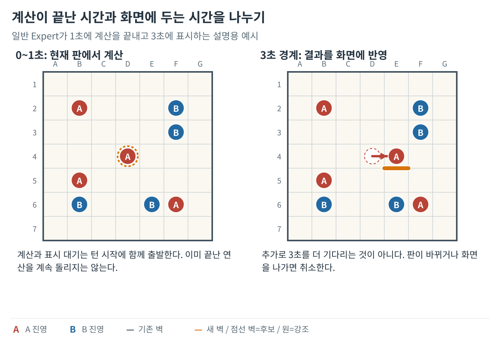
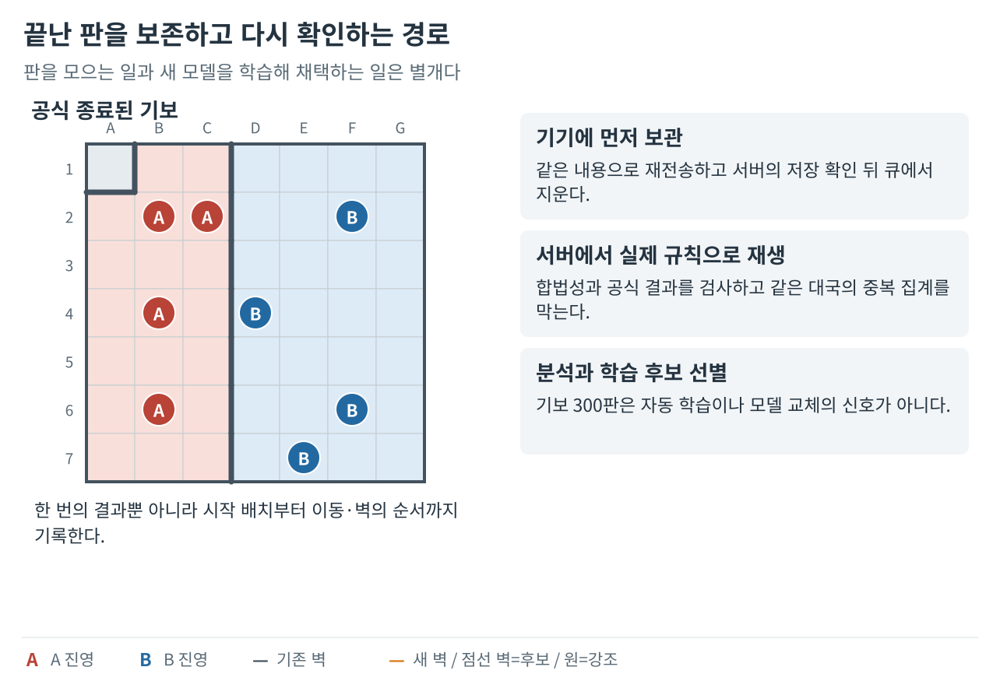
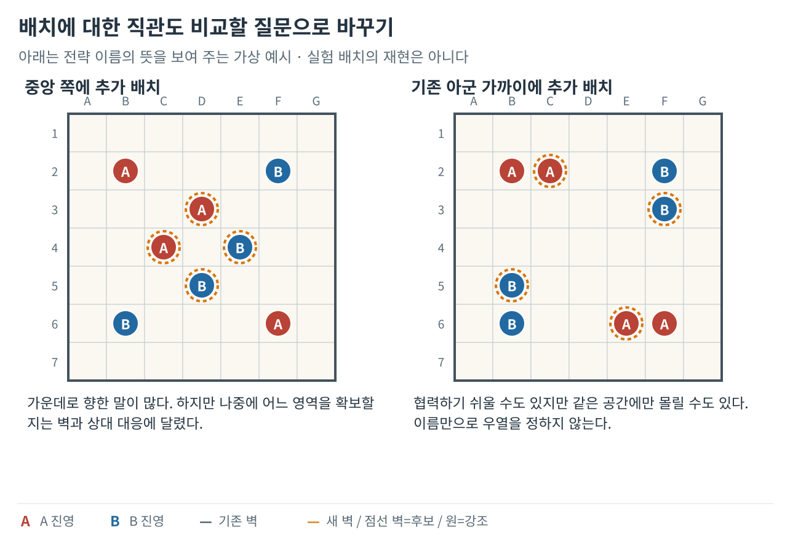
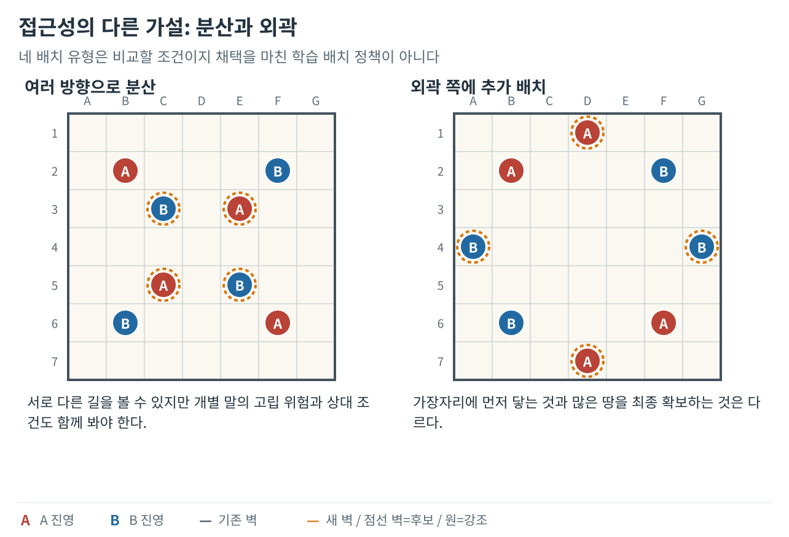
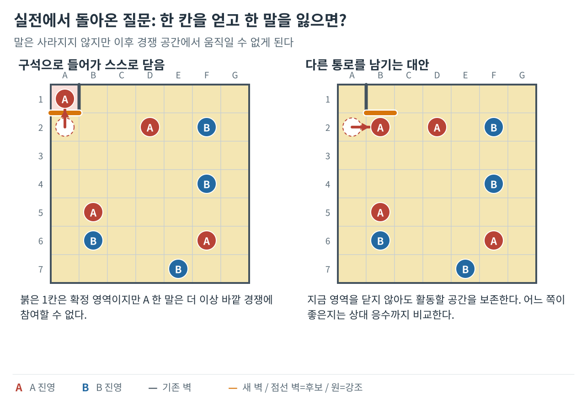
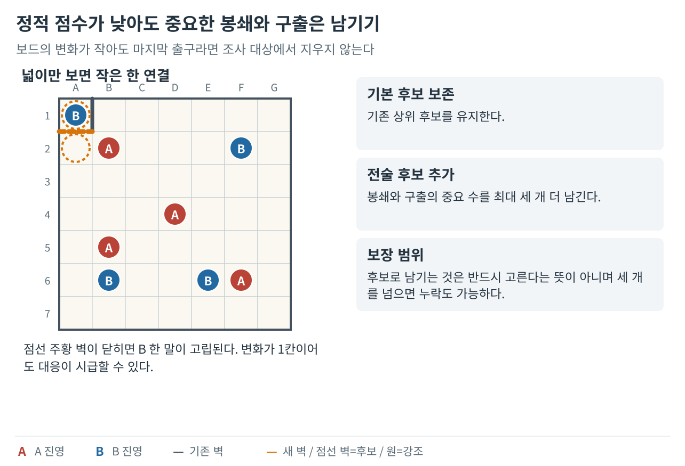
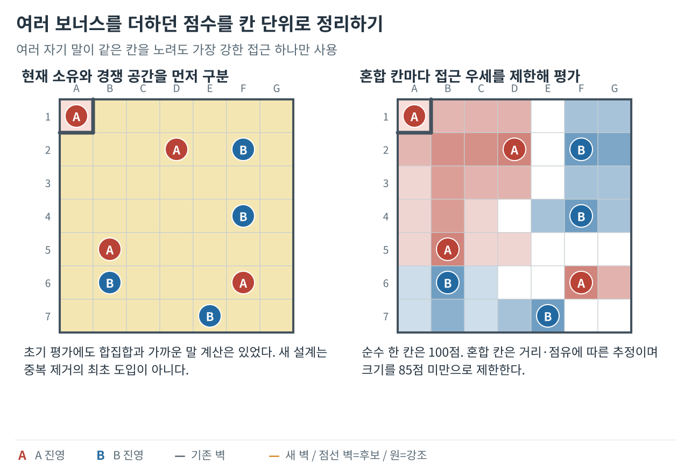
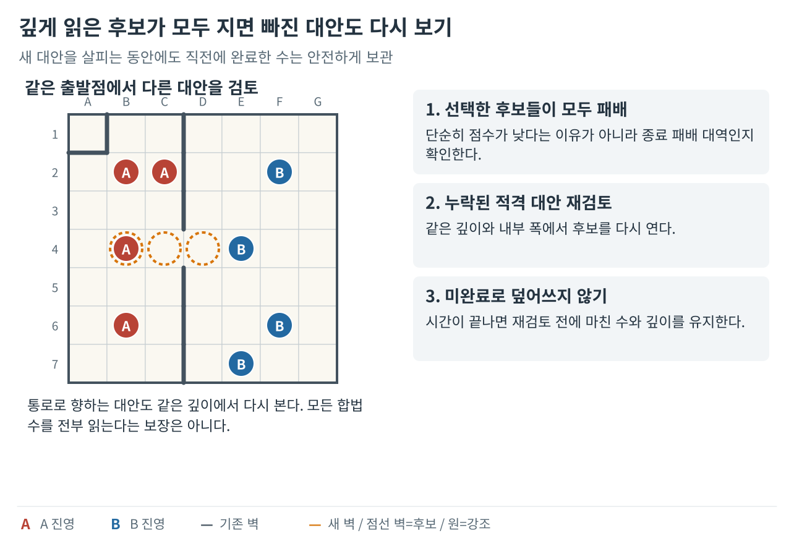

**벽바둑 봇 개발기 시리즈**

1. [좋은 수의 기준을 만들다](/posts/wallbaduk-bot-01/)
2. [안전한 수를 찾고 탐색 시간을 관리하다](/posts/wallbaduk-bot-02/)
3. [기보에서 배워 Expert와 Sedol에 적용하다](/posts/wallbaduk-bot-03/)
4. **실전 패착을 재현해 엔진을 고치다 (현재 글)**

Expert와 Sedol을 만든 뒤, 더 오래 계산하는 것이 실제로 더 나은 수를 고르게 하는지 확인했다. 이번 편에서는 기보를 다시 재생해 패착의 원인을 나누고, 모델을 그대로 둔 채 평가와 탐색을 바꾼 결과를 비교한다.

게임 규칙과 그림 범례는 [1편](/posts/wallbaduk-bot-01/)에서 확인할 수 있다.

## 10. 더 오래 생각하면 강해질 것이라는 가정을 시험했다

**핵심 변화 — 오래 계산하는 것과 강해지는 것, 화면에서 기다리는 시간을 나눠 검증했다.**

계산을 오래 허용하는 일과 사용자에게 오래 기다리게 하는 일도 나눴다. 일반 대전의 Easy와 Normal은 턴 시작 뒤 3초에 수를 보여 주고, Expert는 계산 완료 시점에 따라 3·5·8초 경계에 맞췄다. 계산과 대기는 함께 시작하므로 계산이 끝난 뒤 대기 시간을 새로 더하지 않았다. Sedol에는 별도의 최소 대기를 두지 않았고, 답을 빨리 확인하면 바로 반환했다.

화면을 나가거나 차례가 바뀌면 계산과 대기를 취소했다. 뒤늦게 결과가 와도 요청 때와 현재 판이 다르면 버렸다. 별도 계산 작업은 마지막으로 완료한 수를 계속 보관하다가 시간에 맞춰 끝내도록 했다. 이로써 수를 잘 고르는 문제와 올바른 판에 제때 적용하는 문제를 따로 다룰 수 있었다.

*1초 동안 계산한 수를 3초 경계에 보여 주는 예다. 계산이 끝난 뒤 다시 3초를 더 기다리는 방식이 아니다.*

시간을 늘린 효과는 대결로 확인했다. 같은 Expert의 모델과 판단 방법을 유지하고 상한만 0.5초에서 8초로 늘렸다. 서로 다른 36개 배치에서 색을 바꾼 72판의 결과는 8초 쪽 35승 37패, 승률 48.61%였다. 평균 계산 비용은 약 9.95배 늘었지만 이 표본에서는 승률 향상이 확인되지 않았다. 이 대결만으로 원인을 특정할 수는 없었지만, 더 오래 읽어도 처음에 버린 중요한 수는 다시 읽지 못하고 평가 기준이 잘못되면 그 기준으로 더 깊게 조사할 수도 있었다.

| 비교 조건 | 결과 | 내가 확인한 범위 |
| --- | --- | --- |
| 같은 Expert의 8초 대 0.5초 | 72판 35승 37패 | 시간 확대만으로 개선 확인 못 함 |
| Sedol 15초 대 Expert 8초 | 별도 72판에서 Sedol 49승 23패, 68.06% | 준비 수·증명·반복 대응과 시간 차이가 함께 있는 결과 |
| Expert 8초 대 Normal 3초 | 별도 24판에서 Expert 20승 4패, 83.33% | 깊이·신경망·시간이 함께 다른 난이도 비교 |

이 비교들은 배치를 바꿔가며 같은 구도의 색을 교환했다. 8초 Expert의 승률 구간은 대략 38.89~58.33%, Sedol 대 Expert는 56.94~79.17%로 표본의 불확실성도 남았다. 특히 72판은 앞선 결과를 본 뒤 표본을 확대한 탐색적 비교였다. 시간 확대가 언제나 무효라거나 두 설정이 완전히 같다는 뜻으로 받아들이지는 않았다. 대신 내 다음 개선 대상을 ‘시간’에서 ‘어떤 수를 어떤 기준으로 읽는가’로 옮겼다.

## 11. 기보를 모으되 정답을 만들어 붙이지 않았다

**핵심 변화 — 완주 기보를 안전하게 모아 재검증하고 배치에 대한 직관도 시험했다.**

다음 재료는 실제 수순이었다. 나는 끝난 판의 승패만 저장하는 대신 시작 배치부터 수락된 이동과 벽을 기록했다. 서버에서는 전체 수순을 다시 두어 합법성과 공식 종료 결과를 확인했다. 정상 완주, 합법적으로 진행하다 끊긴 수순, 규칙에 맞지 않는 기록을 구분했다. 중간에 기록이 끝났다는 이유로 넓은 쪽을 승자로 만들거나 무승부를 붙이지 않았다.

같은 판이 다른 모양으로 저장되거나 전송을 다시 해도 중복되지 않게 했다. 시작 배치와 행동 순서가 같은 기록을 구별하고, 종료 직후에는 먼저 기기에 기보를 보관한 뒤 서버가 받았다고 확인할 때까지 같은 내용으로 재시도했다. 계정이 바뀌어도 다른 사람의 기보로 옮겨 붙이지 않았다. 다만 서버가 수순을 검증한다고 해서 기기 안에서 지정된 모델이 실제 실행됐다는 사실까지 증명되는 것은 아니었다.

*기보의 전송과 검증, 분석과 학습, 모델 채택을 별도 단계로 유지했다. 수집 기능이 실행 중인 봇을 자동으로 바꾸지는 않는다.*

화면의 ‘300판’ 조건도 학습 시작 신호와 분리했다. 한국시간 전날까지 서버에 저장된 완주 기보가 300판 이상일 때 사용자가 Sedol을 이긴 비율을 표시한다. 무승부도 전체 판수에 포함하며, 새 응답을 받지 못하면 옛 캐시 승률을 대신 보여 주지 않는다. 300판이 쌓여도 모델은 자동 교체되지 않는다. 수집한 자료를 고르고, 학습하고, 고정 모델을 검증하는 과정은 별도이다.

배치에 대한 내 직관도 시험했다. 양쪽에 같은 Sedol을 두고 중앙·분산·외곽·아군 인접 조건을 비교했다. 주 비교 228판과 다양성을 보완한 별도 48판을 진행했지만, 조건이 달라 두 성적을 합치지는 않았다. 보완 비교에서 인접 배치는 다른 세 전략에 24판 15승 9패였으나, 구간이 약 41.7~83.3%로 넓었다. 중앙도 어떤 상대 구도에서는 7승 1패, 다른 분산 조건에서는 3승 5패였다.

일찍 작은 영역을 닫는 것과 최종 승리도 단순히 이어지지 않았다. 나는 각 턴의 실제 말과 벽으로 영역을 다시 계산했고, 아직 도달하지 않은 턴을 최종판의 값으로 채우지 않았다. 결국 ‘중앙이면 좋다’ 같은 이름보다 구체적인 구도와 상대 조건이 중요했다. 이 연구만으로 배치 정책이나 모델을 바꾸지는 않았다.

*전략 이름의 뜻을 보여 주는 가상 배치다. 중앙이나 인접이라는 이름만으로 좋은 포석이라고 결론 내리지 않았다.*

*실험에서 실제 사용한 모든 배치를 복제한 도판은 아니다. 배치의 위치 효과는 동일한 이동 엔진과 상대 조건을 맞춰 따로 비교해야 했다.*

## 12. 고립된 말의 실패를 점수와 후보 문제로 나눠 고쳤다

**핵심 변화 — 실전 실패를 칸별 평가·전술 후보 보존·누락 대안 재검토로 환류했다.**

기보를 다시 두자 넓은 공간에 가깝다는 이유로 좋은 수처럼 보였지만, 자기 벽으로 출구를 줄이는 선택이 보였다. 작은 영역 한 칸을 얻는 동안 바깥의 활동을 잃어도 점수가 올라가는 경우도 있었다. 나는 마지막에 진 수만 탓하지 않고, 그보다 앞선 벽 방향과 탈출 기회, 상대의 실제 봉쇄 수를 비교했다. 짧은 패배를 피하는 대안이 있어도 더 긴 조사에서는 여전히 질 수 있었으므로, 다른 수를 찾았다는 사실만으로 판을 구했다고 말하지 않았다.

*작은 땅을 얻은 대신 활동할 말 하나를 잃을 수 있다. 오른쪽이 전체 게임의 최선수라고 단정하지 않고, 손익을 구분하는 예로 사용했다.*

문제는 신경망 하나가 아니었다. 실제 봉쇄 응수가 92개 중 18위, 다른 국면에서는 78개 중 8위여서 여섯 개만 읽는 깊은 탐색 밖으로 빠져 있었다. 또 가지치기로 얻은 점수는 정확한 값이 아니라 상한일 수 있었다. 그 값을 끝까지 계산한 결과와 구분해 보니, ‘신경망의 작은 차이가 더 좋은 탈출을 버렸다’는 설명만으로는 맞지 않았다.

*점선 주황 벽은 아직 설치되지 않은 후보다. 한 칸의 변화라도 마지막 출구면 중요한 봉쇄·구출 후보로 남겼다.*

나는 평가를 49칸의 기여로 정리했다. 자기 말만 있는 순수 영역은 한 칸 +100점, 상대 말만 있는 순수 영역은 −100점, 양쪽이 경쟁하는 칸은 두 진영의 접근 정도를 비교하되 최대 크기를 85점 미만으로 제한했다. 말이 없는 중립 영역은 0점이다. 멀수록 접근의 기여가 지수적으로 줄고, 양쪽 모두 먼 칸은 확신도 낮췄다. 거리를 잴 때는 현재 벽과 다른 말의 점유를 반영하고, 같은 진영의 여러 말 중 가장 강한 접근 하나만 사용했다. 먼 칸을 여러 말이 바라본다고 점수가 계속 더해지지 않게 한 것이다.

중복 제거가 이때 처음 생긴 것은 아니다. 이전에도 도달 칸의 합집합이나 가장 가까운 말의 거리를 사용했다. 이번 변화는 칸별 점수로 기준을 통일하고, 별도 이동성 보너스를 없애며, 점유와 절대 거리를 더 직접 반영한 데 있었다. 여기의 85점 상한과 앞의 탐색 85%·신경망 15%는 서로 다른 설정이다. 접근 점수도 실제 소유 확률이나 미래 확보량의 보장은 아니다.

*오른쪽 혼합 칸에서는 붉고 진할수록 A, 파랗고 진할수록 B의 접근 우세다. 흰색은 동률이다. 순수 영역은 별도 고정색이므로 농도로 점수를 비교하지 않는다. 실제 소유 확률이나 미래 확보량을 칠한 그림은 아니다.*

첫 보정도 그대로 성공하지는 않았다. 관문 때문에 상대의 접근을 낮추는 장치가 오히려 작은 주머니를 만드는 수를 좋게 평가해 8판 2승 6패를 기록했다. 이 감쇠 보정은 최종 점수에서 껐다. 말단에서 무조건 더 읽는 연장도 기본 세 턴을 완료하지 못하게 만들어 기본값에서는 뺐다. 대신 작은 봉쇄와 구출 수를 최대 세 개 더 남겼다. 남긴다는 것은 조사한다는 뜻이지 반드시 그 수를 고른다는 뜻은 아니다.

남긴 최상위 후보들이 모두 패배로 평가될 때에는 안전·반복·진행 조건을 통과한 누락 수를 같은 깊이에서 다시 조사했다. 그래도 내부 후보 제한은 남았고, 단순히 점수가 나쁘다는 이유만으로 모든 수를 다시 읽지는 않았다. 재검토 전에 이전의 완료 결과부터 보관해, 새 조사가 시간 안에 끝나지 않아도 완성한 판단을 잃지 않게 했다.

*빠진 대안을 다시 보는 구조와 미완료 결과로 덮어쓰지 않는 구조를 함께 고쳤다.*

최종 확인에서는 같은 신경망을 유지하고 개발에 쓰지 않은 24개 배치를 색 교환해 난이도마다 48판씩, 총 192판을 비교했다. 상대는 각 난이도의 이전 봇이었다. Easy는 39승 9패, Normal은 45승 2패 1무, Expert는 46승 2패, Sedol은 44승 4패였다. 모든 판이 공식 종료했고 전체 수순을 다시 재생했다. 이는 사람 상대 승률이나 새 Expert 대 새 Sedol의 순위가 아니라, 같은 난이도에서 평가·후보·재검토를 고친 묶음의 개선 결과였다.

비용의 한계도 남았다. Expert의 계산 중앙값은 늘었고, Sedol의 중앙값이 줄어도 서로 다른 후속 판을 읽으므로 같은 작업이 빨라진 배율은 아니었다. 한 Sedol 수는 엔진 안에서 약 16.784초가 걸려 15초 설정을 넘었다. 이 비교는 앱의 작업 실행기를 그대로 거치지 않고 엔진을 직접 호출했으므로 둘의 시간 경계도 구분했다. 나는 강도 향상을 확인했지만 모든 환경의 엄격한 15초 반환까지 보장하지는 못했다. 기보는 모델의 먹이만이 아니라, 내가 정한 판단 기준과 읽는 범위를 다시 고치게 하는 개발 도구가 됐다.

## 13. 이 과정에서 달라진 것

| 처음의 질문 | 발전한 답 | 남아 있는 한계 |
| --- | --- | --- |
| 넓어 보이면 좋은 수인가? | 도달 공간과 순수 영역을 구별하고 칸별 접근을 제한해 평가 | 접근은 미래 확보의 증명이 아님 |
| 상대를 가두면 언제나 좋은가? | 자기 고립과 출구 손실, 상대의 봉쇄 응수까지 비교 | 모든 장기 협력 가치를 완전히 읽지는 못함 |
| 더 깊게 읽으면 되는가? | 즉시 패배 검사와 중요한 전술 후보 보존, 누락 대안 재검토 | 깊은 탐색도 내부 후보와 시간 제한을 받음 |
| 기보가 많으면 강해지는가? | 공식 결과·관측 행동·중단과 중복을 구분해 학습 | 사용자 전략 다양성과 모델 일반화가 남음 |
| 모델이 크면 좋은가? | 작은 모델을 실제 탐색의 보조로 사용하고 별도 대결로 확인 | 모델 단독 우위나 모든 상대에 대한 강도를 보장하지 않음 |
| 오래 생각하면 좋은가? | 위험에 맞춰 시간을 쓰고 마지막 완료 결과를 보존 | 엄격한 시간 마감과 실제 기기 성능을 계속 관리해야 함 |

처음에는 내가 직접 둬 보고 유리하다고 느낀 판단을 규칙으로 적었다. 이후에는 그 규칙이 놓친 수를 기보로 찾고, 데이터의 의미를 고치고, 작은 모델과 탐색을 결합했다. 마지막에는 모델을 그대로 두고도 평가와 읽는 범위를 다시 설계해 강도를 높였다.

벽바둑 봇을 만든 과정은 하나의 큰 모델을 완성해 끝낸 작업이 아니었다. **좋은 수의 기준을 세우고, 그 기준이 틀린 장면을 재현하고, 고친 부분과 아직 모르는 부분을 구별해 가는 과정**이었다.

---

[← 이전 글: 기보에서 배워 Expert와 Sedol에 적용하다](/posts/wallbaduk-bot-03/)
