# **[논문 리뷰] Mechanisms of Object Localization in Vision–Language Models**

> **Mechanisms of Object Localization in Vision–Language Models**
>
> Timothy Schaumlöffel, Martina G. Vilas, Gemma Roig
>
> CVPR 2026
>
> [[arXiv](https://arxiv.org/abs/2605.19792v1)] [[Paper](https://openaccess.thecvf.com/content/CVPR2026/html/Schaumloffel_Mechanisms_of_Object_Localization_in_Vision-Language_Models_CVPR_2026_paper.html)]

## **Background**

### **Visual Token에서 Bounding Box까지**

LLaVA 계열의 VLM은 이미지를 ViT로 인코딩하고, patch feature를 MLP projector로 LLM의 embedding 공간에 맞춘다. LLM은 펼쳐진 visual token과 텍스트 지시를 함께 읽고 답변을 생성한다. 이 논문의 localization에서는 별도의 detection head가 아니라 **LLM이 생성한 텍스트에서 bounding box 좌표를 파싱**한다.

이미지 전체와 텍스트를 맞추도록 학습한 CLIP은 장면이 무엇인지 표현하는 데 유용하다. 그러나 전체 이미지 수준의 supervision만으로 객체의 정확한 경계를 직접 학습하는 것은 아니다. [Eyes Wide Shut? 리뷰](/posts/EyesWideShut/)가 이런 시각 표현의 실패를 다뤘다면, 여기서는 그 표현을 입력받은 **LLM이 어디서 어떤 정보를 꺼내 좌표를 만드는지** 추적한다.

### **Classification과 Localization의 차이**

사진에 자전거가 있다는 판단에는 바퀴나 핸들처럼 일부 특징만으로도 충분할 수 있다. 자전거의 bounding box를 맞히려면 왼쪽 끝과 오른쪽 끝이 어디인지도 알아야 한다. 따라서 **같은 이미지 증거를 쓰더라도 어느 위치에 어떤 feature가 있는지에 대한 요구가 다르다.**

또한 이 논문의 localization prompt는 대상 클래스 이름을 이미 알려준다. 분류의 답변을 먼저 생성해서 다음 prompt로 전달하는 실험이 아니다. 논문이 말하는 **identification → grounding**은, 위치를 물었을 때도 모델 내부에서 해당 객체의 시각적 증거를 식별하는 연산을 거칠 수 있다는 가설이다.

### **읽어낼 수 있는 정보와 실제로 쓰이는 정보**

어떤 layer의 feature에서 좌표를 예측할 수 있다면 좌표 정보가 **decodable**하다고 할 수 있다. 하지만 별도로 학습한 classifier가 읽을 수 있다는 것만으로 원래 VLM도 그 정보를 사용한다고 결론낼 수는 없다.

이 논문은 그래서 개입을 함께 사용한다. 특정 token의 내용을 바꾸거나, attention 연결을 막거나, 다른 실행의 head activation을 옮긴다. **무엇을 바꿨을 때 출력이 달라지는가**를 보면, 단순히 attention이 큰 위치를 관찰하는 것보다 정보가 실제 계산에 기여하는지를 더 직접적으로 비교할 수 있다.

## **Introduction**

객체를 알아보고 좌표까지 생성하는 VLM을 보더라도, 정확한 위치가 어느 단계에서 만들어지는지는 출력만으로 알기 어렵다. 객체의 내부 배치까지 읽는지, 객체로 보이는 feature가 놓인 바깥 경계만으로 충분한지, 또는 배경을 보고 위치를 추측하는지 결과가 같을 수 있기 때문이다.

### **Goal**

고정된 LLaVA-1.5와 InternVL-3.5에서 **객체의 존재와 공간적 범위를 나타내는 정보가 어디에 있고, 어느 layer와 attention head를 거쳐 출력에 영향을 주는지** 분석한다.

### **Motivation**

- 객체와 배경이 함께 나타나는 이미지에서는 모델이 실제 객체를 본 것인지 맥락으로 맞힌 것인지 구분하기 어렵다.
- 객체 영역과 token 순서를 따로 조작하면, 어떤 feature가 있는지와 그 feature가 어디에 놓였는지의 영향을 나눠 볼 수 있다.
- 위치를 읽어낼 수 있는 layer를 찾는 것과, 그 layer의 특정 연결이나 head가 답변에 기여하는지 확인하는 것은 다른 문제다.

### **Contributions**

1. 객체 token을 평균 feature로 대체하거나 주변으로 복사하고, 순서도 섞어 **객체 token이 차지하는 범위와 내부 배열**을 분리해 본다.
2. InternVL의 global thumbnail과 local tile을 따로 개입하고, layer별 linear probe로 **2D 위치가 얼마나 읽히는지** 확인한다.
3. Attention knockout으로 후보 layer를 좁히고, activation patching과 누적 head ablation으로 **분류와 위치 추정에 중요한 경로가 얼마나 겹치는지** 확인한다.

## **Method**

### **분석 대상: LLaVA와 InternVL의 시각 입력**

| 모델 | Vision → Language | LLM 입력 grid |
| --- | --- | --- |
| LLaVA-1.5 7B / 13B | CLIP ViT-L/14 → Vicuna | 24×24 |
| InternVL-3.5 8B | InternViT-300M → Qwen3-8B | view당 16×16 |

두 모델 모두 vision encoder와 LLM 사이에 두 층 MLP를 둔다. LLaVA는 이미지를 정사각형으로 padding한 뒤 336×336으로 맞춘다. 576개 patch feature는 공간 집계 없이 LLM 입력 token과 일대일 대응한다. InternVL은 448×448 view를 독립적으로 인코딩하고 2×2 feature 블록을 한 token으로 묶는다. 실험에서 local tile은 최대 6개다.

InternVL의 global view는 **전체 이미지의 축소본**이고, local view는 **같은 이미지에서 자른 고해상도 tile**이다. [UniCompress 리뷰](/posts/UniCompress/)에서 dense feature를 query로 요약한 global token과는 뜻이 다르다. InternVL의 경우 전체 좌표계를 한 번에 볼 수 있는 view와 작은 객체를 더 자세히 볼 수 있는 view를 따로 가릴 수 있다.

두 모델 계열은 encoder·언어 backbone·시각 입력 구성도 다르다. 따라서 이후 layer 위치의 차이를 **pixel shuffle이나 multi-view 설계 하나의 영향**으로 해석할 수는 없다.

### **Dataset: 같은 장면에서 객체만 제거한 대조군**

COCO validation의 annotation을 보정한 뒤, 이미지 면적의 0.4% 미만 또는 60% 초과 객체, 짧은 변이 200px 미만인 이미지, 질문한 클래스의 객체가 여러 개인 사례를 제외한다. 이 단계에서는 **3,560장·6,403개 객체 annotation**이 남는다. 다른 클래스의 객체는 여전히 함께 있을 수 있다.

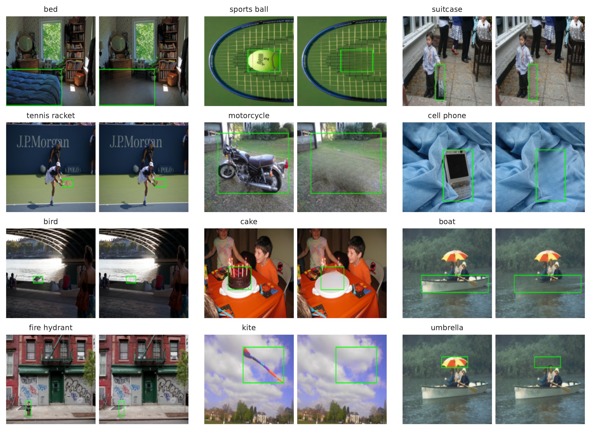

같은 이미지에서 대상 객체를 지우고, 그 자리를 LaMa inpainting으로 채운다. 예를 들어 Figure 6의 경기장에서는 공이 있던 영역을 채우되 주변 경기장 맥락은 가능한 한 남긴다. 경기장만 보고도 공을 계속 답하는 모델이라면, 그 쌍으로 공의 시각적 증거가 어디에서 처리되는지 해석하기 어렵다.

원본에서는 객체를 맞히고 제거본에서는 해당 객체를 답하지 않는 쌍을 고른다. 세 모델에 대해 이 조건을 만족하는 교집합은 **1,720장·2,248개 annotation**이다. 이후 결과는 이 통제된 표본에 대한 분석이다. 이미지 생성기가 제거 영역 밖의 맥락까지 완벽히 동일하게 유지한다는 보장이나, 필터링한 성능이 전체 COCO의 성능을 대표한다는 뜻은 아니다.

### **Tasks와 평가 지표**

- **Classification:** COCO 클래스 목록을 제시하고 이미지에 존재하는 객체를 나열하게 한다. 대상 클래스명이 답변에 포함되면 맞힌 것으로 센다. 다른 클래스를 잘못 나열해도 이 대상의 점수에서 직접 감점되지는 않는다.
- **Localization:** 대상 클래스 이름을 주고 해당 객체의 box 좌표를 생성하게 한다. 정답과 겹치는 면적을 IoU로 계산하고, 0.5·0.7·0.9의 세 기준을 넘긴 비율을 평균한다.

$$
\begin{aligned}
\operatorname{IoU}(\hat B,B)
&=\frac{\operatorname{area}(\hat B\cap B)}{\operatorname{area}(\hat B\cup B)} \\
\operatorname{Loc}
&=\frac{1}{3}\sum_{\tau\in\{0.5,0.7,0.9\}}
\frac{1}{N}\sum_{i=1}^{N}
\mathbf{1}\left[\operatorname{IoU}(\hat B_i,B_i)>\tau\right]
\end{aligned}
$$

- $\hat B_i,B_i$: $i$번째 사례의 예측 box와 정답 box
- $\tau$: IoU 성공 기준. 값이 클수록 더 정밀한 box가 필요하다.
- $N$: 평가 사례 수
- $\mathbf{1}[\cdot]$: 조건을 만족하면 1, 아니면 0
- $\operatorname{Loc}$: 세 기준에서 계산한 성공률의 평균. 원문 표는 %로 표시한다.

따라서 localization 35.34%는 평균 IoU 0.3534나 detection mAP가 아니다. 35.34%에서 5.92%로 내려가면 **29.42 percentage point(pp) 감소**이다.

분류 prompt를 왜 나열형과 yes/no로 나누는가?

  

대상이 없는 이미지에 대해서도 yes/no prompt에서는 “있다”는 답이 자주 나온다. 부록에서 보고한 false positive rate는 세 모델에서 yes/no **0.56–0.70**, 클래스 나열형 **0.27–0.45**이다. 따라서 일반 분류 평가는 나열형으로 진행한다.

반면 후반의 causal mediation에서는 같은 정답 token의 확률을 비교해야 한다. 객체 이름이 응답 어디에 등장할지 일정하지 않은 나열형보다, 긍정 응답을 기준으로 채점할 수 있는 yes/no가 적합하다. **정답 확률을 비교하는 CMA의 분류 prompt와 자유 생성 정확도를 비교하는 일반 분류 prompt가 다르다.**

  

 

### **네 가지 분석 도구가 바꾸는 것**

| 분석 | 바꾸거나 읽는 대상 | 확인할 것 |
| --- | --- | --- |
| Token 조작 | LLM 입력 visual feature | 객체 증거의 위치와 범위 |
| Linear probe | Layer별 visual hidden state | 행·열의 선형 decodability |
| Attention knockout | 객체 key로 향하는 연결 | 중요한 layer 구간 |
| Head patching·ablation | 개별 head activation | 정답 회복과 출력 의존성 |

기존 VLM을 새로 학습하거나 fine-tune하지 않는다. 학습하는 것은 위치를 읽기 위해 붙인 **linear probe**이며, 그 probe가 VLM의 실제 답변 경로에 들어가지는 않는다.

## **Experiments**

### **1. Visual Token Ablation: 객체 증거를 어디서 읽는가?**

이미지를 encoder에 다시 넣어 수정하는 대신, **multimodal projector를 지난 직후 LLM 입력 feature**를 수정한다. 선택한 위치의 embedding을 ImageNet validation에서 미리 계산한 평균 visual embedding으로 대체한다. 시각 입력에 가까운 통계를 가진 값으로 내용을 흐리되, token 수와 슬롯은 그대로 둔다.

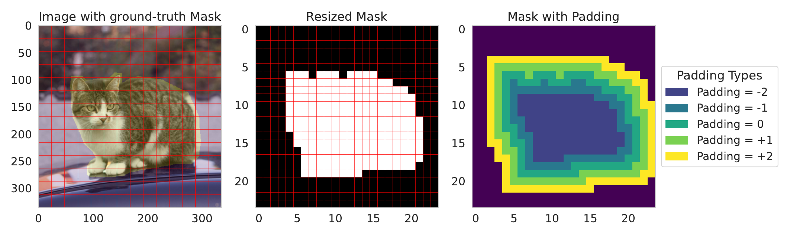

Figure 7에서 segmentation mask가 한 픽셀이라도 겹치는 patch를 객체 token으로 표시한다. $p=0$은 원래 객체 영역, $p<0$은 바깥층을 걷어낸 좁은 영역, $p>0$은 주변 token을 포함한 넓은 영역이다. **음수 padding에서는 안쪽 token을 대체하더라도 객체의 가장자리 feature가 남을 수 있다.**

비교군은 세 가지다. Integrated Gradients는 분류 정답 logit이나 box 좌표에 대한 attribution으로 높은 점수의 token을 고른다. Random은 token을 무작위로 선택하고 seed 3개를 평균한다. Register는 embedding norm이 평균보다 표준편차 2개 이상 높은 token을 고른다.

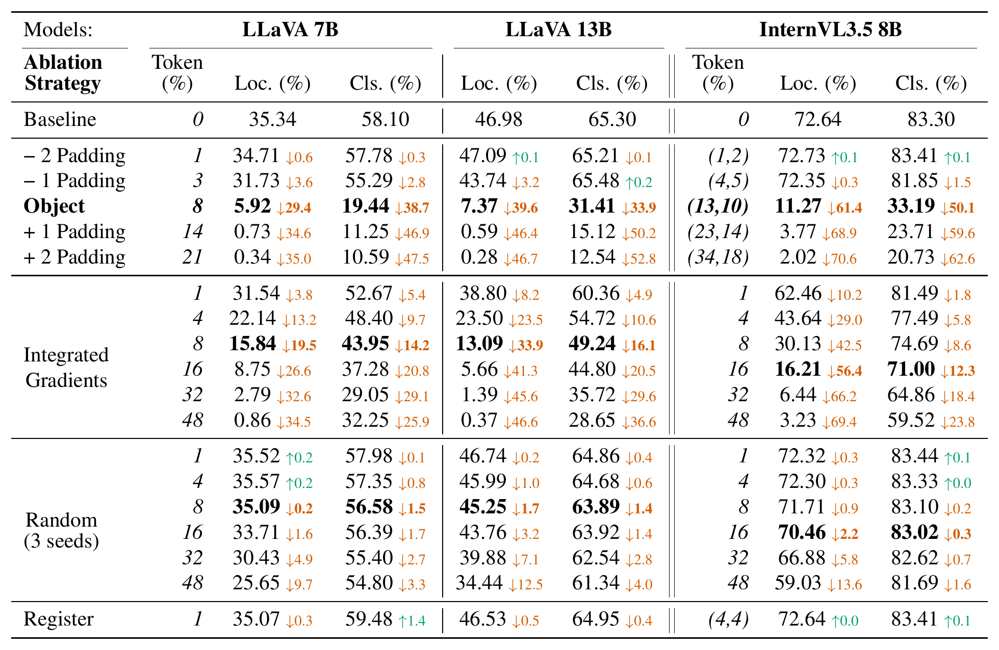

LLaVA-7B에서 전체 token의 약 8%를 무작위로 바꾸면 localization이 35.34% → 35.09%이지만, 같은 비율의 **객체 token**을 바꾸면 **5.92%**가 된다. 높은 IG 점수로 고른 8%를 바꾸면 15.84%다. 분류도 객체 token 대체에서 58.10% → 19.44%로 크게 하락한다.

| 모델 | Localization: 원본 → 객체 영역 대체 | Classification: 원본 → 객체 영역 대체 |
| --- | --- | --- |
| LLaVA-1.5 7B | 35.34% → 5.92% | 58.10% → 19.44% |
| LLaVA-1.5 13B | 46.98% → 7.37% | 65.30% → 31.41% |
| InternVL-3.5 8B | 72.64% → 11.27% | 83.30% → 33.19% |

InternVL의 객체 대체 비율은 **global 13%, local 10%**다. 표에서 강조된 random·IG 16% 행은 가까운 규모의 비교군이지 view별 비율까지 일치시킨 대조군은 아니다. InternVL의 localization 11.27%도 원문 본문의 “10% 미만”이라는 요약에 포함되지 않는 예외다.

세 모델 모두 객체 주변까지 대체하면 localization이 더 낮아진다. 반면 안쪽만 대체하는 음수 padding의 변화는 상대적으로 작다. 객체 경계 근처나 마스크에 포함되지 않은 이웃 token이 증거를 제공할 수 있다는 결과다. 다만 양수 padding은 대체하는 **개수와 범위를 동시에** 늘리므로, 주변 token 하나의 기여를 따로 측정한 것은 아니다.

다른 데이터에서도 객체 위치의 token이 중요한가?

  

부록 Table 5는 같은 전처리를 적용한 Pascal VOC **1,585장·1,957개 객체**에서 비슷한 경향을 보인다. 예를 들어 LLaVA-7B의 localization은 52.41%에서 객체 token 대체 후 9.52%로 떨어지지만, 무작위 대체에서는 50.41%다. InternVL에서는 객체 대체 26.35%와 IG 대체 27.00%가 비슷하다. 따라서 객체 영역과 무작위의 차이는 재현되지만, 객체 영역이 항상 IG보다 큰 차이로 중요하다고 볼 수는 없다.

고노름 register 대체의 효과가 작았다는 점도 **이 선택 기준과 두 task에서의 결과**다. 모든 종류의 전역 정보가 불필요하다는 뜻은 아니다.

  

 

### **2. Object Containerization: 배치보다 바깥 범위가 중요한가?**

객체 token을 없앴을 때 box를 못 맞힌다는 결과만으로는 모델이 객체의 경계를 어떻게 정하는지 알 수 없다. 저자들은 반대로 **객체 feature가 있는 공간 범위를 인위적으로 넓힌다.**

1. 원래 객체 영역의 token을 무작위로 뽑는다.
2. 뽑은 feature를 마스크 바깥 한두 층의 슬롯에 복사한다. 픽셀과 원래 객체 내부 token은 그대로다.
3. 생성한 box를 원래 정답 box와, 각각 한 층·두 층에 대응해 확장한 정답 box에 따로 비교한다. 복사할 token을 바꿔 10개 seed로 반복한다.

앞 절의 양수 padding은 주변을 **평균 embedding으로 대체해 증거를 없애는 것**이고, 이 실험은 주변에 **객체 embedding을 복사해 증거를 추가하는 것**이다. 겉보기에는 같은 token grid를 넓혀도 개입 방향이 반대다.

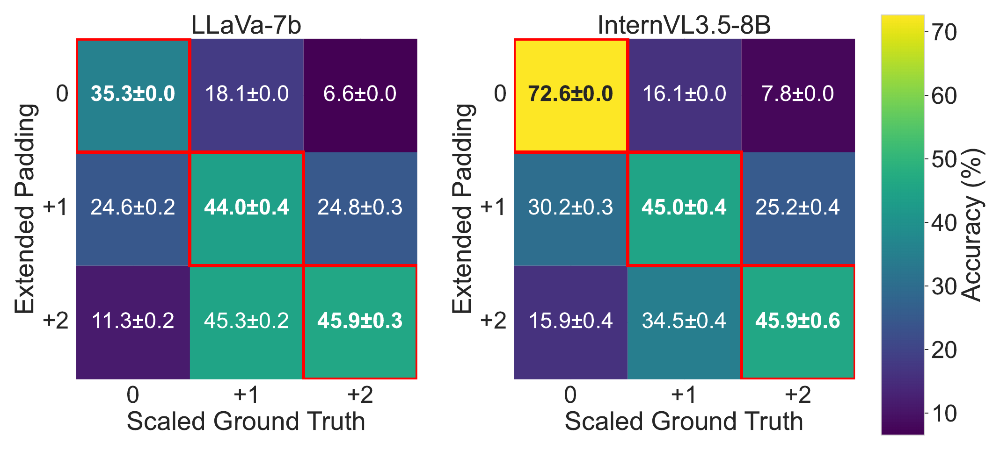

Figure 1의 행은 입력에 추가한 padding, 열은 평가할 정답 box의 확장 정도다. **같은 행 안에서** 어느 열이 가장 높은지 봐야 한다. LLaVA-7B의 $+1$ 입력은 원래 box와 비교하면 24.6%, $+1$ 정답 box와 비교하면 **44.0%**다. InternVL도 같은 비교에서 30.2% → **45.0%**다. LLaVA-7B의 $+2$ 입력은 $+1$ 정답에서 45.3%, $+2$ 정답에서 45.9%로 거의 비슷하므로, 매번 정밀하게 한 칸씩 따라간다는 해석은 과하다.

복사된 feature는 서로 자연스럽게 배치된 실제 객체의 부분이 아니다. 그럼에도 예측 box가 추가된 슬롯 쪽으로 확장된다는 점에서, 저자들은 **객체에 속한다고 판단한 token들의 공간적 범위가 box를 정하는 단서**라고 해석한다. 이 관찰에 붙인 이름이 **containerization**이다. 별도의 container module을 구현했다는 뜻은 아니다.

LLaVA-13B에서도 확장한 박스에 맞춰지는가?

  

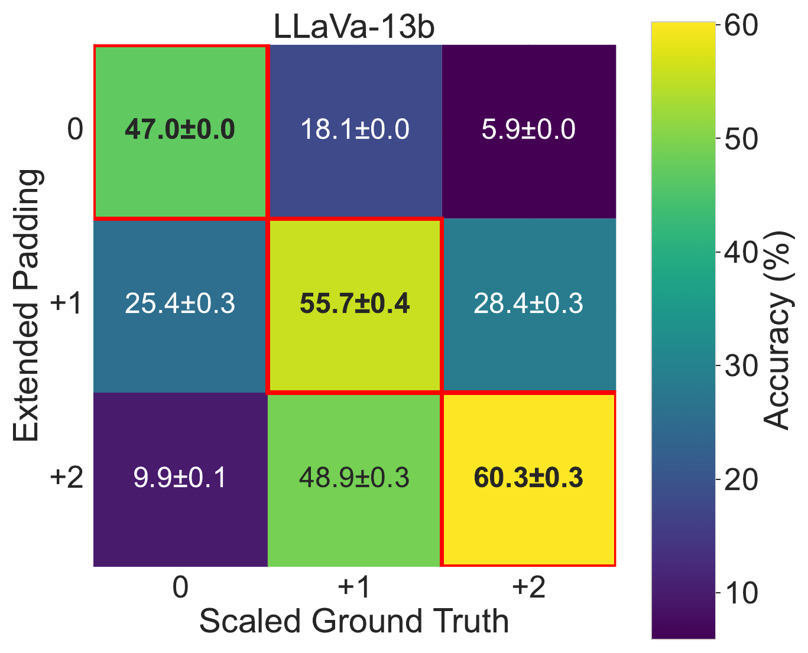

부록 Figure 8에서 $+1$ 입력의 localization은 원래 정답 box에서 25.4%, $+1$ 정답에서 **55.7%**다. $+2$ 입력은 $+2$ 정답에서 **60.3%**로 가장 높다. 서로 다른 행의 점수는 정답 box 조건도 달라질 수 있으므로 baseline 대비 성능 향상으로 해석하지 않는다.

  

 

#### **Object-only Shuffle: 어느 정도까지 내부 순서가 필요 없는가?**

토큰을 대체하거나 추가하지 않고, 이번에는 **같은 feature를 다른 슬롯으로 이동**시킨다. 객체 마스크 안에서만 섞으면 해당 영역의 token 집합과 바깥 범위가 유지된다. 전체를 섞으면 배경과 객체 feature의 위치 관계까지 바뀐다.

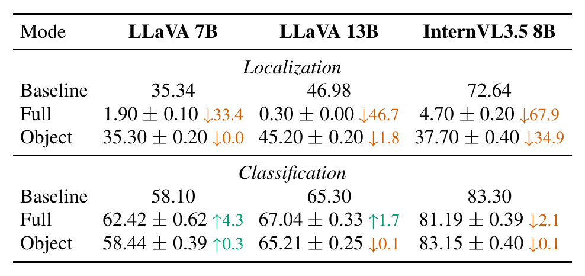

- **LLaVA-7B:** 객체 내부만 섞으면 localization 35.34% → 35.30%, 전체를 섞으면 1.90%다.
- **LLaVA-13B:** 객체 내부만 섞으면 46.98% → 45.20%, 전체를 섞으면 0.30%다.
- **InternVL-3.5 8B:** 객체 내부만 섞어도 **72.64% → 37.70%**로 34.94pp 하락한다. 전체를 섞었을 때의 4.70%보다 높지만, 내부 배치가 중요하지 않다고 보기에는 큰 변화다.

분류는 객체 내부 shuffle에서 거의 유지되고, 전체 shuffle의 변화도 localization보다 작다. 전체 shuffle에서 LLaVA 두 모델의 분류는 오히려 소폭 상승하고 InternVL은 2.11pp 하락한다. **어떤 객체 feature가 있는가**와 **그 feature가 어느 좌표에 놓였는가**의 중요도가 두 task에서 다르다는 결과다.

Containerization은 특히 LLaVA에서 잘 들어맞는 설명이다. InternVL에서도 범위를 넓히면 box가 커지지만, 그 사실과 내부 배치가 필요 없다는 주장은 별개다. 이 실험만으로 InternVL의 하락을 특정 view의 배치나 pixel shuffle에 귀속할 수는 없다.

### **3. Global vs. Local Views: 전체 좌표계와 세부 묘사**

InternVL에서 객체 token의 의미를 지우되, **global thumbnail만**, **local tile만**, 또는 **두 view 모두** 수정한다. View 자체를 통째로 빼는 실험은 아니다.

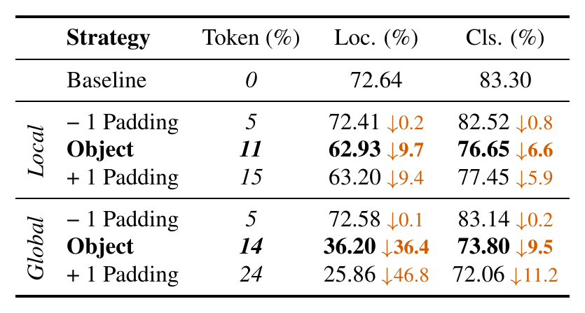

Baseline localization 72.64%는 global의 객체 token만 대체하면 **36.20%**(−36.44pp), local만 대체하면 **62.93%**(−9.71pp)가 된다. 두 view를 함께 대체하면 11.27%다. 분류는 각각 73.80%, 76.65%, 33.19%이며 baseline은 83.30%다. **전체 평균에서는 두 task 모두 global 대체의 영향이 더 크지만, 그 격차는 localization에서 더 뚜렷하다.**

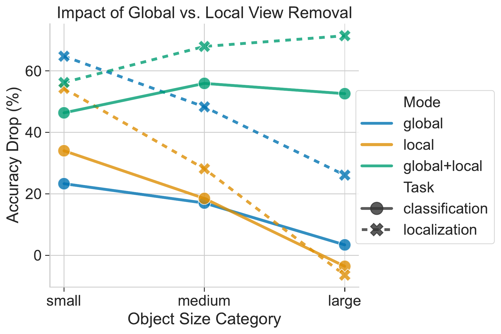

Figure 10은 COCO의 box 면적 기준으로 small·medium·large를 나눈다. 점선의 localization을 보면 작은 객체는 global만 바꿔도 64.8pp, local만 바꿔도 54.3pp 떨어진다. 작은 객체의 분류에서는 local 대체의 영향이 global보다 크다. 반대로 큰 객체는 local만 대체했을 때 localization이 6.5pp 올라간다. 그래프에서 0 아래가 그 경우다.

전체 위치를 알기 쉬운 thumbnail과, 작은 물체를 자세히 볼 수 있는 tile의 장점은 다르다. 다만 local은 분류에만 쓰이고 global은 위치에만 쓰인다는 분업은 아니다. 두 view를 함께 대체할 때 **전체 평균** 하락이 가장 큰 것 역시 모든 크기 구간에서 성립하지 않는다.

### **4. Positional Decoding: 1D Sequence에서 행과 열을 읽을 수 있는가?**

Visual token은 2D grid에서 왔지만 LLM 입력에서는 1D sequence다. 한 layer의 token hidden state만 보고 **원래 patch의 열과 행**을 맞힐 수 있는지 확인하기 위해, 위치별 정답이 있는 linear classifier를 붙인다.

$$
\hat c_{\ell,a,i}
=\arg\max_k\left(W_{\ell,a}\,h_{\ell,i}+b_{\ell,a}\right)_k,
\qquad a\in\{x,y\}
$$

- $h_{\ell,i}$: layer $\ell$의 $i$번째 visual token hidden state
- $a$: 독립적으로 예측하는 열($x$) 또는 행($y$) 축
- $W_{\ell,a},b_{\ell,a}$: layer와 축마다 별도로 학습하는 linear probe의 weight와 bias
- $k,\hat c_{\ell,a,i}$: 해당 축의 후보 위치와 예측 위치

위 식은 원문 절차를 풀어 쓴 것이다. ViT 각 layer, MLP projection 출력, LLM 각 layer에서 probe를 따로 학습한다. ImageNet 50,000장으로 10 epoch 학습하고 10,000장으로 평가한다.

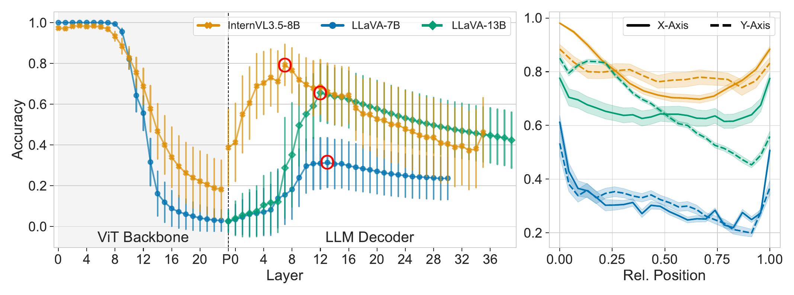

왼쪽 그래프에서 ViT 초반은 위치를 쉽게 읽을 수 있지만, 뒤로 갈수록 정확도가 크게 낮아진다. $P$는 projector 출력이다. LLaVA의 $P$는 거의 바닥까지 내려간 반면 InternVL은 위치 신호가 일부 남는다. LLM에 들어간 뒤 정확도는 다시 상승한다. 그림의 빨간 표시 기준 최대치는 **LLaVA-7B layer 13 약 0.31, LLaVA-13B layer 12 약 0.66, InternVL layer 7 약 0.79**다. 원문 §3.2의 LLaVA layer 순서는 Figure 2·11과 서로 바뀌어 있어, 여기서는 그림을 따른다.

오른쪽은 최고 layer에서 축별 상대 위치에 따른 정확도다. 실선은 $x$, 점선은 $y$이다. 양끝이 비교적 잘 읽힌다. 부록 Figure 11에서는 LLaVA의 projector 출력에도 코너에 강한 신호가 남고, LLM 안에서는 더 넓은 위치에서 좌표를 읽을 수 있음을 보여준다.

코너가 잘 읽힌다는 것이 LLM이 코너를 쓴다는 증거인가?

  

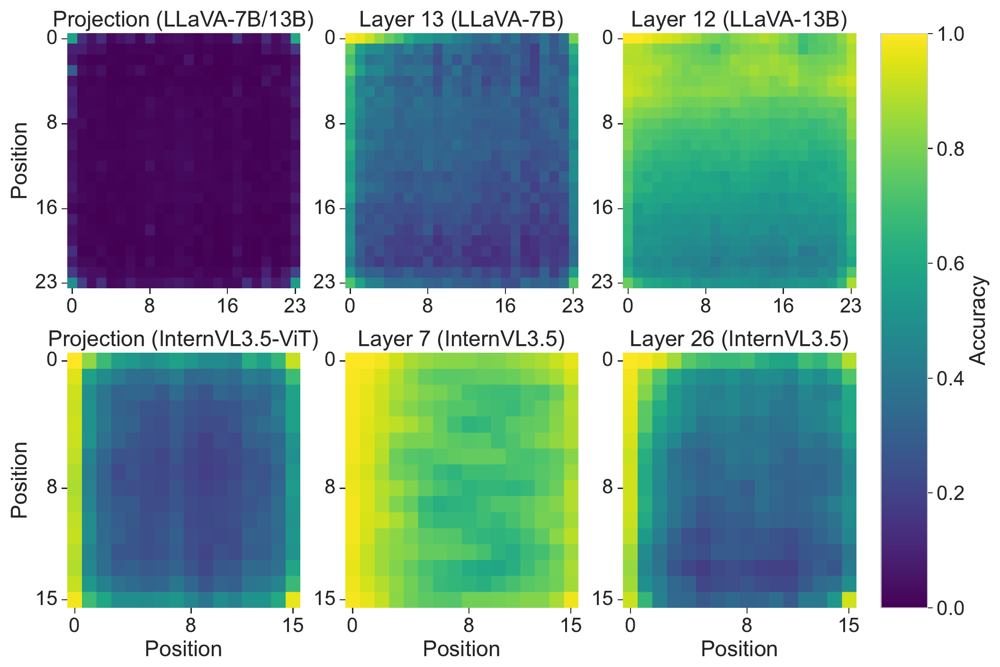

펼친 2D grid에서 행의 끝과 다음 행의 시작은 1D sequence상에서 바로 붙어 있다. 남아 있는 코너·경계 신호와 순서 정보가 행의 경계를 추정하는 기준점이 될 수 있다는 것이 저자들의 해석이다. InternVL의 projection map에는 코너 외에도 경계와 내부 일부에 위치 신호가 보인다.

이 실험에서는 코너만 개입하거나 제거하지 않았다. 따라서 확인된 것은 **LLM layer에서 위치 정보의 선형 decodability가 다시 높아진다**는 점이다. ViT 후반에서 모든 위치 정보가 사라졌거나 LLM이 특정 코너 알고리즘으로 2D grid를 복원한다고 확정할 수는 없다.

  

 

### **5. Attention Knockout: 어느 Layer에서 객체 증거를 직접 읽는가?**

객체 token의 feature를 건드리지 않은 상태에서, **이미지 구간 뒤의 query가 객체 token을 key로 읽는 연결**을 막는다. Attention 행렬에서는 뒤쪽 query 행과 객체 key 열이 만나는 원소를 softmax 전 $-\infty$로 마스킹하는 것으로 이해할 수 있다.

$$
\begin{aligned}
A_{ij}^{(\ell,h)}
&=\operatorname{softmax}_{j}
\left(\frac{q_i^{\top}k_j}{\sqrt{d_h}}+M_{ij}\right) \\
M_{ij}&=-\infty\quad(i\in\mathcal{Q}_{\mathrm{post}},\ j\in\mathcal{O})
\end{aligned}
$$

- $A_{ij}^{(\ell,h)}$: layer $\ell$, head $h$에서 query 위치 $i$가 key 위치 $j$를 읽는 가중치
- $q_i,k_j,d_h$: query, key, head의 feature 차원
- $\mathcal{Q}_{\mathrm{post}}$: 이미지 token 구간 뒤의 query 위치 집합
- $\mathcal{O}$: 객체 마스크에 해당하는 visual key 위치 집합
- $M_{ij}$: 기존 attention mask에 추가하는 차단 항. 지정된 구간에서 위 연결만 차단한다.

실험에서는 연속 네 layer의 모든 head에 이 차단을 걸고 구간을 바꿔 본다. 전체 layer를 막은 조건도 둔다. 차단은 특정 구간의 **직접적인 읽기 경로**에 적용되므로, 다른 토큰이나 앞 layer를 거쳐 이미 전달된 정보가 전부 지워지는 것은 아니다.

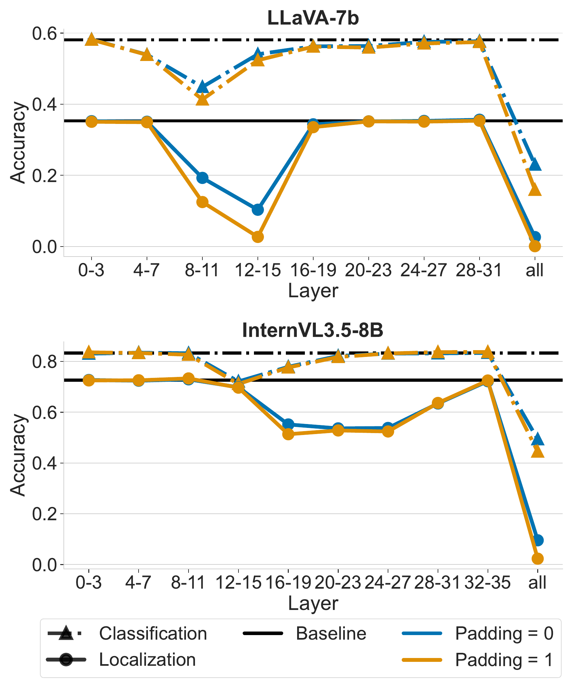

Figure 3에서 점선은 분류, 실선은 localization이다. LLaVA-7B에서는 분류가 **8–11 layer** 구간에서 가장 크게 떨어지고, localization은 **12–15 layer**에서 크게 하락한다. InternVL은 분류 영향이 **12–15**, localization은 **16–27**의 여러 구간에서 두드러진다. LLaVA-13B와 한 layer·여섯 layer 단위의 비교는 부록 Figure 12에 제시한다.

개별 layer보다 여러 layer를 함께 차단할 때 영향이 커질 수 있다. 일부 연산은 여러 layer에 걸쳐 정보가 전달되거나 다른 경로가 손실을 보완할 수 있다는 단서다. **이 단계는 head 하나의 역할까지 밝히지 못하므로**, 이어서 개별 head의 activation을 이식한다.

### **6. Causal Mediation Analysis: 어떤 Head가 정답을 회복시키는가?**

같은 대상에 대해 원본과 객체 제거본을 사용한다. 핵심은 객체 제거본을 다시 원본 이미지로 바꾸지 않고, **선택한 head의 prompt 위치 activation만 원본 실행에서 가져오는 것**이다. 이 분석에는 선별된 subset에서 50장을 사용한다.

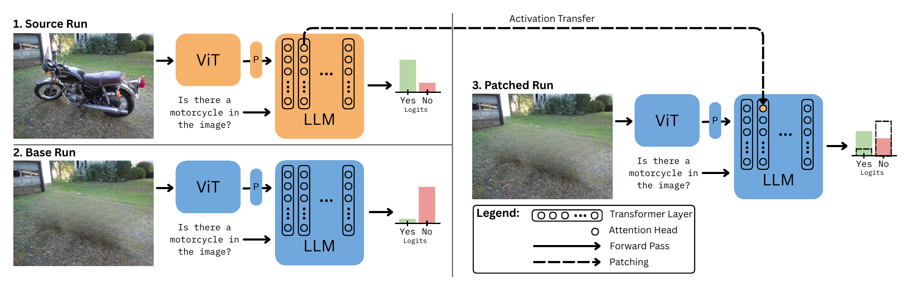

1. **Source:** 객체가 있는 원본 이미지를 실행해 각 head의 activation과 정답의 perplexity를 얻는다.
2. **Base:** 대상 객체를 inpainting으로 제거한 이미지를 실행한다.
3. **Patched:** base 입력은 그대로 두고 한 head의 prompt token activation을 source의 대응 값으로 바꾼다. 이 상태에서 나머지 forward 계산을 진행한다.
4. Head를 바꿔 가며 정답 perplexity가 얼마나 낮아지는지 측정한다.

분류는 yes/no prompt의 정답을, localization은 정답 box 답변을 teacher forcing으로 채점한다. 세 실행에 **원본 이미지의 정답**을 공통으로 주고, 같은 정답 prefix 아래에서 다음 정답 token의 확률을 비교한다. Box 응답의 괄호처럼 예측이 거의 고정된 형식 token은 점수에서 제외한다. 여기서 patching 후의 개선은 자유 생성한 box의 IoU가 아니라, **정답 token이 더 높은 확률을 받았는가**이다.

채점에 포함된 token의 평균 negative log-likelihood를 지수화하면 perplexity가 된다. 아래 식은 원문의 채점 절차를 풀어 쓴 것이다.

$$
P=\exp\left(
-\frac{1}{|\mathcal{T}|}
\sum_{t\in\mathcal{T}}\log p_\theta(y_t\mid u,y_{<t})
\right)
$$

- $\mathcal{T}$: 형식 token을 제외한 채점 위치 집합
- $y_t,y_{<t}$: 해당 위치의 정답 token과 앞쪽 정답 prefix
- $u$: 이미지와 prompt가 주는 입력 조건
- $p_\theta$: 해당 실행에서 고정된 VLM이 내는 다음 token 확률. Patched run에서는 head activation에 개입한다.

형식 token은 위 합에서 빼지만, 뒤 정답 token을 예측할 때의 prefix에는 포함된다. 정답 확률이 높을수록 $P$는 작다.

논문의 Eq. (1)은 제거 전후 생긴 perplexity 차이 중 patch가 메운 비율을 계산한다.

$$
\mathrm{MF}=\frac{P_{\mathrm{base}}-P_{\mathrm{patched}}}{P_{\mathrm{base}}-P_{\mathrm{src}}}
\tag{1}
$$

- $P_{\mathrm{src}}$: 원본 이미지에서 정답 token의 perplexity
- $P_{\mathrm{base}}$: 대상 객체를 제거한 이미지에서의 perplexity
- $P_{\mathrm{patched}}$: 제거본 실행에 선택한 head의 activation을 이식했을 때의 perplexity
- $\mathrm{MF}$: Mediation Fraction. 아래 해석은 원본이 제거본보다 정답을 잘 예측해 $P_{\mathrm{base}}>P_{\mathrm{src}}$인 경우다.

예를 들어 $P_{\mathrm{base}}=10$, $P_{\mathrm{src}}=2$, $P_{\mathrm{patched}}=6$이면, 원래 차이 8 중 4를 메워 $\mathrm{MF}=0.5$다. $\mathrm{MF}=1$은 그 실행에서 원본 수준의 perplexity를 회복했다는 뜻이다. 0에 가까우면 이식에 따른 회복이 작고, 음수면 제거본보다 정답을 더 못 예측한다.

MF가 높으면 그 head 하나면 충분한가?

  

MF는 확률이 아니어서 0과 1 사이에 갇히지 않는다. Patched가 source보다 정답을 더 잘 예측하면 1을 넘을 수 있고, source–base 차이가 거의 0이면 분모가 작아 해석이 불안정해진다.

또한 source activation은 앞에서 일어난 다른 연산의 결과이고, 이식한 뒤에도 base run의 downstream module이 작동한다. **이 개입에서 회복을 일으킨다**는 결과를, 그 head가 단독으로 객체를 식별하고 box를 완성한다는 의미로 읽을 수 없다. 반대로 MF가 0에 가까워도 단일 이식으로 회복되지 않았을 뿐, 다른 head와 함께 쓰이거나 여러 입력에서 다른 역할을 할 수 있다.

  

 

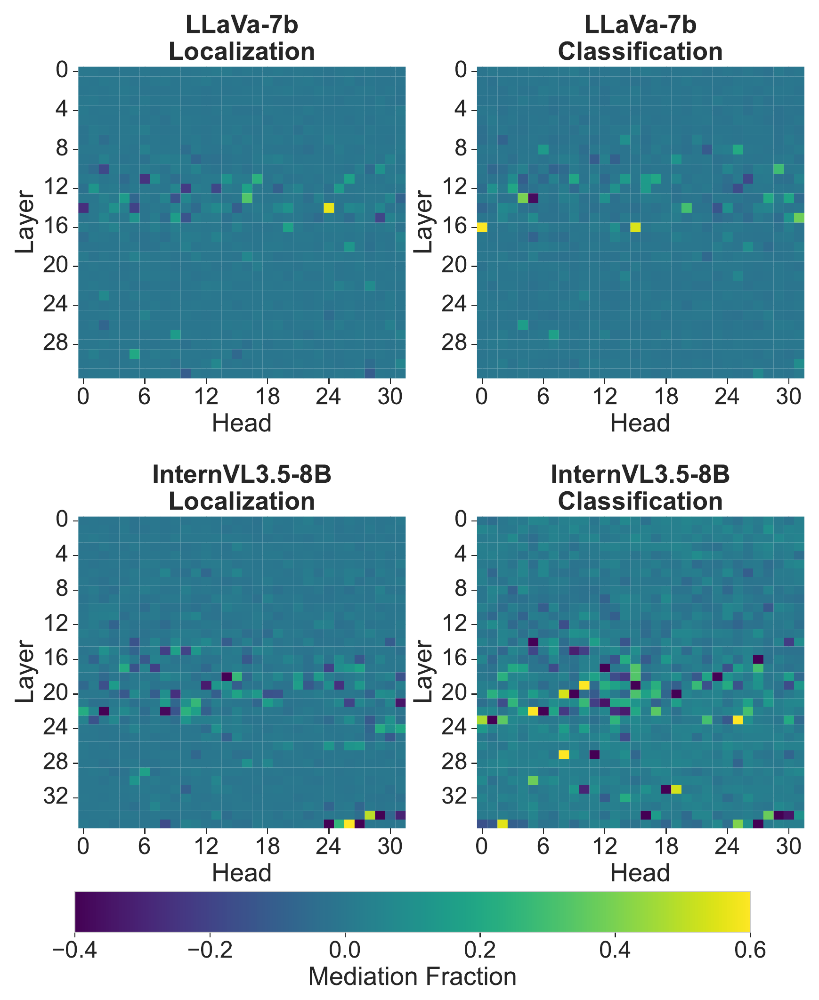

Figure 4의 가로축은 head, 세로축은 layer다. LLaVA에서는 주로 **11–16**, InternVL에서는 **16–22**에 양의 MF가 두드러진다. 특히 InternVL에서는 음수와 후기 layer의 예외도 보인다. 음수는 원본 activation을 제거본의 다른 activation들과 합쳤을 때 오히려 채점 결과가 나빠졌다는 뜻이며, 그 head가 일반적으로 오답을 담당한다는 증거는 아니다.

Top-10 MF head의 교집합은 LLaVA에서 2개, InternVL에서 1개다. Top-50으로 늘려도 LLaVA-7B **20개**, LLaVA-13B **15개**, InternVL **18개**다. 두 task의 강한 mediator가 상당 부분 다르지만, ranking 겹침이 적다는 것만으로 회로가 독립적이라고 결론낼 수는 없다.

### **7. Cumulative Head Ablation: 분류 쪽 Head를 끄면 위치도 무너지는가?**

앞 실험은 원본 activation을 **추가했을 때 회복되는지** 본다. 이번에는 localization 또는 classification에서 평균 MF가 높은 head부터, 또는 MF가 0에 가까운 head부터 선택해 **forward 중 출력을 0으로 만든다.** 세 조건 모두 최종 평가 지표는 localization이다.

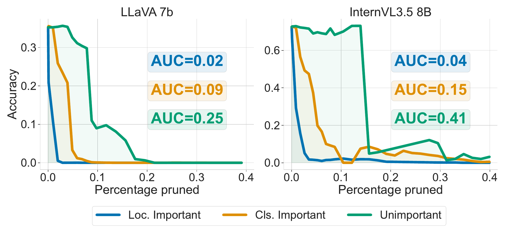

파란색은 localization에 중요한 head, 주황색은 classification에 중요한 head, 초록색은 낮은 MF head부터 차단한 결과다. Figure 5의 normalized AUC는 같은 비율로 head를 차단할 때 localization 점수가 얼마나 유지되는지를 요약한다. **이 실험에서는 AUC가 낮을수록 해당 그룹을 끊었을 때 피해가 더 크다.**

| 모델 | Loc. 중요 순 | Cls. 중요 순 | MF가 0에 가까운 순 |
| --- | ---: | ---: | ---: |
| LLaVA-7B (Fig. 5) | 0.02 | 0.09 | 0.25 |
| LLaVA-13B (부록 Fig. 15) | 0.01 | 0.09 | 0.30 |
| InternVL-3.5 8B (Fig. 5) | 0.04 | 0.15 | 0.41 |

Localization head부터 막을 때 점수가 가장 빠르게 내려간다. **분류용으로 고른 head부터 막아도** 낮은 MF head를 같은 비율로 막는 것보다 localization이 더 크게 하락한다. 직접적인 box 계산과, box를 계산할 대상이 무엇인지 식별하는 중간 표현이 다른 head에 나뉘면서도 연결될 수 있다는 결과다.

다만 낮은 MF head의 초록색 곡선도 충분히 많이 차단하면 급락한다. 가로축의 “Percentage pruned”는 **출력을 0으로 만든 head의 비율**이다. 모델에서 weight나 연산을 제거하여 속도를 높인 것이 아니며, 안전하게 pruning할 수 있는 head 비율을 산출한 실험도 아니다.

## **Conclusion**

VLM의 객체 위치 추정에는 **객체 feature가 무엇인지**와 **그 feature가 이미지의 어느 범위를 차지하는지**가 모두 필요하다. 객체 token을 평균값으로 바꾸면 무작위 대체보다 크게 떨어지고, 주변 슬롯에 복사하면 예측 box도 커지는 경향이 있다. 내부 순서를 섞는 실험에서는 LLaVA와 InternVL의 차이가 커서, containerization만으로 세 모델의 세부 동작을 모두 설명할 수는 없다.

Layer별 probe는 위치가 다시 잘 읽히는 구간을 보여주고, attention knockout은 그 주변에서 어떤 직접 경로에 의존하는지 보여준다. 이어 head별 patching과 ablation을 함께 보면, **분류에서 중요한 일부 계산이 localization에도 필요하고, 좌표 추정에는 별도의 강한 mediator가 있다**는 그림이 나온다. 이는 객체 식별에 뒤이어 공간적 범위를 계산한다는 해석을 뒷받침한다.

### **Limitations**

- **표본 범위:** 질문한 클래스가 하나만 있고, 세 모델이 객체 제거 여부를 구분하는 COCO 쌍을 골랐다. 같은 클래스가 여러 개 있는 장면, 복합 지시, segmentation·video로 일반화했는지는 확인하지 않았다.
- **개입 범위:** 평균 feature와 inpainting, activation 이식은 통제 방법이지만 자연스러운 실행과 다른 입력·activation 조합을 만든다. MF는 특정 source–base 쌍과 teacher-forced 목표에 대한 결과다.
- **회로 범위:** head는 분석 단위 중 하나다. MLP·residual 경로와 학습 중 회로가 만들어지는 과정은 다루지 않는다. 분류 중요 head를 끈 후 localization을 평가한 결과이며, 반대 방향이나 모든 사례에서의 엄격한 순차 실행을 증명하지 않는다.
- **적용 범위:** 효율적 crop 선택이나 head fine-tuning은 후속 아이디어다. 이 논문은 새 grounding 학습법이나 배포용 pruning의 성능을 검증하지 않는다.
