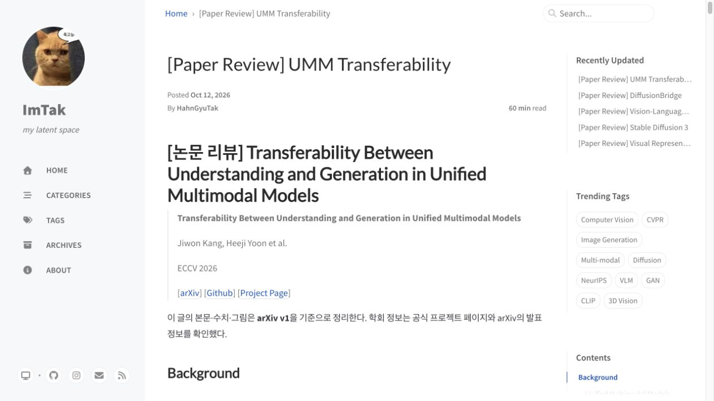
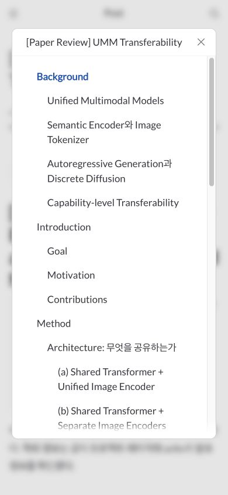

# Chirpy 병합 및 검증 기록

대상 원본: `cotes2020/jekyll-theme-chirpy@ae1057257b3927d6474deb549bdfafa71244e080`, 버전 7.6.0 기반 master.
기존 블로그 기준: `c5f35889aeb23474705c91092c0972e0d224a58b`.

임시 Git 복사본에서 원본을 실제 병합하고 충돌 32건을 해결한 뒤 아래 검증을 수행했다. GitHub 푸시는 이 작업에 포함하지 않는다.

## 보존한 내용

- 기존 Markdown 글 44편의 본문과 front matter는 변경하지 않았다. 주제 디렉토리, 제목 계층, 서지정보 quote, dollar 수식, 표와 HTML 토글도 그대로다.
- favicon을 제외한 기존 이미지 389개 및 관련 보조 파일의 내용은 보존했다.
- 기존 글 URL 44개가 이전 빌드와 일치한다.
- 개인 제목·설명·시간대·avatar·작성자·GitHub/Instagram·Analytics·Google 검증 값 및 기존 footer 설정을 이관했다.
- 기존 favicon 이미지의 바이트와 이름을 유지했다. manifest는 실제 이미지 경로와 사이트 이름을 사용하도록 수정했다.
- 기존 WallaGo 페이지와 tabs 내용, 작성 지침, 사용자의 수정된 `.DS_Store` 및 미추적 이미지 폴더는 보존 대상이다.

## 해결한 문제

| 문제 | 처리 |
| --- | --- |
| 설정·레이아웃 충돌 | 최신 구조에 기존 개인 값과 메뉴 동작 이관 |
| 여러 MathJax/KaTeX 로더와 중복 head | 최신 MathJax 로더 하나로 통합, 기존 `use_math` 키 지원 |
| SplatFlow의 `\text{shared_K}` 렌더링 오류 | MathJax 4의 textmacros를 비활성화해 기존 text-mode 동작 유지. Markdown 원문 수정 없음 |
| Utterances 직접 삽입과 새 댓글 로더의 중복 가능성 | 테마 설정의 Utterances provider로 통합, 기존 repo와 pathname 연결 유지 |
| Google Analytics·SEO 코드 중복 | 테마의 Analytics 및 SEO 플러그인 출력 사용 |
| 오래된 `/../assets/` 이미지 경로 | 미디어 URL·이미지 렌더링 단계에서 `/assets/`로 정규화 |
| `3D-editing`/`3d-editing` 태그 주소 충돌 | 같은 slug의 archive를 합치는 hook 추가, 글의 tags 원문 유지 |
| 누락된 Bootstrap CSS·theme/PWA JS | 새 빌드로 생성하고 출력물·의존성 lockfile 포함 |
| 새 모듈 체계와 기존 PurgeCSS 설정의 불일치 | 기존 설정을 ES module 및 새 lint 형식으로 이관 |
| 배포 workflow 이동 충돌 | 개인 블로그 workflow 유지, Node/npm 빌드와 새 html-proofer 호출 추가 |
| 불필요한 원본 데모 글·개발 workflow 복구 | 기존 삭제 의도 유지 |
| 내부 작성 문서의 사이트 출력 | `_writing/`, `AGENTS.md`와 포스팅 보조 스크립트 제외 |

MathJax 호환 설정 근거: [공식 textmacros 문서](https://docs.mathjax.org/en/v4.1/input/tex/extensions/textmacros.html).

## 검증 결과

| 검사 | 결과 |
| --- | --- |
| `npm ci --ignore-scripts` | lockfile로 설치 성공 |
| `npm run build` | CSS 및 JS 9개 bundle 생성 성공 |
| `npm test` | JavaScript·SCSS lint 통과 |
| `bundle exec jekyll serve` | 임시 개발 서버 실행 및 브라우저 확인 |
| `JEKYLL_ENV=production bundle exec jekyll build` | 성공, 태그 출력 충돌 경고 해결 |
| HTML-Proofer | HTML 142개, 내부 링크 1,140개 및 글 44개의 anchor 검사 통과 |
| 렌더링된 JavaScript 문법 | 11개 파일 `node --check` 통과 |
| production 브라우저 검사 | 글 44편에서 MathJax 오류 및 페이지 가로 넘침 없음 |
| 글 주소·원문 보존 | 기존 URL 44개 일치, 보호 대상 파일 내용 대조 통과 |
| loader 중복 | 각 글의 head 1개, MathJax 엔진 1개, Analytics 로더 1개 |
| XML·manifest | feed와 sitemap 파싱 성공, favicon manifest의 이미지 경로 유효 |
| PWA | app/sw bundle 및 설정 파일 출력 확인, production 콘솔 오류 없음 |
| 인터랙션 | 모바일 팝업 목차, 토글 내부 수식, GLightbox 이미지 확대, 검색, 명암 모드 및 재방문 설정 확인 |

브라우저의 페이지별 결과는 [검사 JSON](chirpy-upgrade-proof/browser-validation.json)에 기록했다. 검사 시 수식 컨테이너 3,358개를 관찰했다. 수식이 없는 글도 페이지 검사에 포함했다.





## 실행 환경과 재현

검증 환경은 macOS arm64, Ruby 3.2.2, Node 22.16.0이며, 새 Ruby/npm lockfile을 포함한다. Ruby lockfile에는 GitHub Actions용 Linux platform도 추가했다. 현재 블로그의 Ruby 버전을 유지하고 `.ruby-version`으로 명시했다.

저장소 루트에서 실행한다.

```sh
bundle install
npm ci --ignore-scripts
npm run build
bundle exec jekyll serve
```

production 확인은 별도로 수행한다.

```sh
JEKYLL_ENV=production bundle exec jekyll build
bundle exec htmlproofer _site --disable-external
npm test
```

이번 로컬 검증은 GitHub Actions의 실제 원격 실행을 대신하지 않는다. 원격 배포와 공개 사이트 확인은 푸시 승인 후 수행해야 한다. 외부 논문 링크와 외부 서비스 전체의 지속적인 가용성도 보장하는 검사는 아니다.

## 의존성 감사 범위

`npm audit --omit=dev`는 취약점 0개였다. 전체 npm 감사에는 원본의 개발·릴리스 도구 의존성에서 24개(중간 2, 높음 22)가 보고됐다. 일반 패치 업데이트를 시도했지만 미해결 항목과 npm 내부 bundled dependency가 남았다. 이 항목들이 모두 수정됐다고 기록하지 않는다. 강제 major 변경으로 원본 도구를 교체하지 않았으며, 해당 개발 패키지를 사이트의 정적 파일로 배포하지 않는다.

이 문서의 “검증 통과”는 위 기능·빌드·렌더링 검사에 대한 결과다.
